# The AI assistant: an idea → a flyer, and a flyer → its share text

Branch `feat/ai-assistant`, 2026-10-02 to 2026-10-04, cut from `feat/flyer-briefs` (`1fbc991`). 24 commits,
unpushed. The brief is `docs/prompts/ai-assistant.md`; it was continued by
`docs/prompts/ai-assistant-continue.md` (Phase 3) and `docs/prompts/ai-assistant-continue-phase5.md` (Phase 5 to
the end). The review (`docs/prompts/ai-assistant-review.md`) ran on 2026-10-05 in a fresh session on another model,
and the session that closed the feature is the last section here, *Follow-up*.

## What it is

- **"✨ Create with AI"** (`#/ai`, reached from the library's bar). A staff member pastes their text; a model writes
  the brief, with what it had to assume and the flyer's share text; the page shows the flyer through the app's own
  renderer. "Open in editor" hands it over as a new, unsaved flyer.
- **"✨ Write with AI"**, in the editor's Share text section, writes the caption from what the fields say now.
- **Off until a site has a key.** Then nothing of it shows, and the app is as it was.
- **At most 3 generations a day**, both features together, counted on the Canary Islands day.
- **Both backends** (Node and PHP) answer the same two routes, and **two providers** (OpenAI, Anthropic) sit
  behind one seam, with a fake one for the tests. Which provider runs is configuration.

## Artur's decisions

| When | What |
|---|---|
| 2026-10-01, the brief | OpenAI first, then Anthropic, both adapters from day one, and a fake for the tests. The cap: 3 a day, in the code, one counter for both features; a generation counts only when its answer passed validation; the day is the Canary Islands day. No key means no AI and no AI UI. Who may use it is a seam (an actor and a policy), for the login to fill. A separate "Create with AI" page, and one button in the Share text section |
| 2026-10-02, Phase 0 | The default models: `gpt-6-luna` (OpenAI) and `claude-haiku-4-5` (Anthropic). The AI may run on the live site while it is still unlocked: strangers could spend the day's 3 before staff do, and the cap keeps the cost there |
| 2026-10-03 | Phases 3 and 4 committed. For Phase 5: Claude runs the real calls, and a key is never printed; no stop between Phase 5 and Phase 6; `tests/storage/json.test.ts` gets 30 s; the Phase 4 screenshots go into git |

## What each phase built

| Phase | Commits | What |
|---|---|---|
| 1. The shared sources and the contract | `f5b76f2` | `src/shared/ai.ts`; the AI schemas and `BriefSchema`'s limits in `schema.ts`; five errors (`ai_off`, `ai_forbidden`, `ai_quota`, `ai_input`, `ai_failed`); the rules moved into `ai/prompts/`; `schema/ai.json` (prompts, few-shot, schemas) from `npm run gen`; the two routes in `docs/api-contract.md`; both backends answering them off |
| The ledger | `40f84d0` | one append-only record per generation, in both Node drivers: SQLite's migration 3 (`ai_usage`), the JSON store's `ai-usage/YYYY-MM.json`; the copy tool carries it |
| 2. Node | `cae300e` | `server/ai/`: the provider seam and its three adapters, the schema dialects, the prompt builder, the service, the actor and the policy, the routes; the `node-ai` contract project |
| 3. PHP, the peer | `79c0c62` … `8bbc759` | `php/src/Ai/`: the same seams over curl, replaying the same five vector files; the ledger in the JSON store; `config.php`'s `ai` block (`AiConfig`); the routes; the `php-ai` contract project; curl in the host facts and the preflight page |
| 4. The client | `c704651`, `ee0fdd9` | `AiPage.tsx` (`#/ai`), `handoff.ts`, "Write with AI", the bar entry; the form pieces moved out of `Editor.tsx` into `panel.tsx` and `share.tsx`; `tests/render/ai.spec.ts` on a second server with the fake provider |
| 5. A real call | `566d823` … `1490956` | the thirteenth-assumption slip; the settings' refusals; `scripts/site.ts`; `npm run ai:smoke`; the real calls, and the fault they found |
| 6. The docs | this commit and the one before | `docs/deploy.md`, `docs/ai-flyers/README.md`, `README.md`, `CLAUDE.md`, this report |

## Phase 5: what was built before the real calls

- **The thirteenth assumption** (`566d823`). A model answer with 12 assumptions and a made-up hostel left the
  service with 13, past the answer's limit. On both backends the service's "Unknown hostel" note still comes first,
  and on a full list it takes the place of the model's last one. The 12 has a name, `AI_ASSUMPTIONS_MAX`, which PHP
  reads from `shared.json`.
- **The settings refuse a bad value without repeating it** (`944764d`). `loadAiSettings` quoted the `AI_PROVIDER`
  it refused, so a key pasted on that line of `.env` would have been printed back. `AI_TIMEOUT_MS=25s` became `NaN`
  and was recorded as a network failure. PHP's `AiConfig` already did both right.
- **`scripts/site.ts`** (`977e5cd`): the one way a script calls a site's API. `flyers:post` used to do it inline. A
  redirect is refused, with the address it points to: a POST that follows a 301 arrives as a GET.
- **A guard on Anthropic's limits** (`523c969`): at most 24 optional properties and 16 union-typed ones in a
  request's schemas, or every generation answers 400. The flyer answer had 17 and 1, and has 16 and 1 since the
  share text became required. A test counts them.
- **`npm run ai:smoke`** (`5e36809`): one real generation, by hand.
  - Direct, it runs the provider `.env` names, composed as `server/index.ts` composes it, over a ledger in memory.
    It refuses the fake, a missing key and a switched-off AI.
  - `--to <app root>` goes through a site's API. It asks `api/config` first, and a release from before the AI, the
    AI off and a used-up day each stop it there, with nothing spent.
  - `--share` writes the caption of the example's flyer.
  - Everything but the two calls themselves is tested without the network.
- **`tests/storage/json.test.ts`** (`f243ac2`) has 30 s, set for the whole file: one of its three blocks is the
  shared repository contract, which a `describe` option in that file would not reach.

## The real calls (2026-10-04)

The first example's text (the sunset stretching class), held out of the few-shot, so each brief is the model's own.
`.env` was checked by a script that printed only yes or no. The Anthropic key was taken from `.env` into the
environment without being printed.

| # | Call | Model that answered | Tokens in / out | Time |
|---|---|---|---|---|
| 1 | OpenAI, flyer | `gpt-6-luna` | 3854 / 658 | 8.4 s |
| 2 | OpenAI, share text | `gpt-6-luna` | 1645 / 408 | 5.0 s |
| 3 | Anthropic, flyer (the first call with this schema) | `claude-haiku-4-5-20251001` | 5267 / 139 | 20.8 s |
| 4 | Anthropic, flyer again | `claude-haiku-4-5-20251001` | 5267 / 144 | 3.7 s |
| 5 | Anthropic, share text | `claude-haiku-4-5-20251001` | 2199 / 378 | 4.7 s |
| | *after the share text became required (below):* | | | |
| 6 | Anthropic, flyer (a new schema, so the first call again) | `claude-haiku-4-5-20251001` | 5302 / 483 | 20.6 s |
| 7 | OpenAI, flyer | `gpt-6-luna` | 3871 / 585 | 6.3 s |
| 8 | Anthropic, flyer again | `claude-haiku-4-5-20251001` | 5302 / 473 | 4.4 s |
| | *through PHP, on the Laragon copy (Apache, mod_php 8.4.25, curl), with both examples in the few-shot:* | | | |
| 9 | OpenAI, flyer | `gpt-6-luna` | 4529 / 722 | 6.7 s |
| 10 | OpenAI, share text | `gpt-6-luna` | 2267 / 454 | 5.0 s |

What they showed:

- **Both adapters worked at the first attempt.** No provider refused a request, a schema or a header.
- **OpenAI answers in 5 to 9 seconds.** `AI_EFFORT` was never needed.
- **Anthropic's first call with a new schema takes about 20 seconds,** then 4 to 5. It compiles the schema once and
  keeps it for a day (its docs, read 2026-10-02). 20.8 s and 20.6 s are close to the 25 s limit: on a slower day
  that first call fails, counts nothing, and the next one works.
- **The cost,** at the prices read on 2026-10-02: a flyer is about 0.08 cents on `gpt-6-luna` and about 0.8 cents
  on `claude-haiku-4-5`. Three a day is 0.25 or 2.3 cents.
- **The Canary day, on a real record.** Call 9's ledger record has `at: 2026-10-03T23:32:41Z` and
  `day: 2026-10-04`.
- **PHP's curl verified the provider's certificate** with Laragon's CA bundle from 2022 (`curl.cainfo` in its
  `php.ini`). The site's error log gained no line.

### The fault the real calls found

**Anthropic's flyer came back without its share text, twice out of twice** (calls 3 and 4: 139 and 144 tokens out).
`share` was optional in the answer's schema, and the prompt says to leave a key out rather than guess it. OpenAI's
strict dialect makes every key required, so `gpt-6-luna` wrote one. The brief's rule is that one generation is a
whole flyer.

Fixed in `1490956`, test first on both backends:
- `AiFlyerAnswerSchema` requires the share text, so a provider's structured output has to write it, and both
  backends answer `ai_failed`, uncounted, for an answer without it;
- PHP needed no code: it holds the answer to the generated schema;
- `BriefSchema` is unchanged, so a brief written by hand may still go without one;
- the prompt says the same in two lines, and `npm run gen` refuses an example that could not be the answer it shows.

Calls 6 to 8 are the proof: each provider answered a flyer with its share text.

### The briefs, read against the one written by hand

The text names no hostel and no price; Artur supplied both when the example was written ("Adeje Nest", "Free").

| | By hand | `gpt-6-luna` (call 1) | `claude-haiku-4-5` (call 6) |
|---|---|---|---|
| Hostel | `adeje-nest` | every hostel, said in an assumption | every hostel, said in an assumption |
| Headline | Stretching class / at sunset. | Stretch, breathe / and watch sunset. | Stretching & / sunset class. |
| When, where | Today · 19:00, Pool area | the same | the same |
| Cost | Free | Ask at reception, said in an assumption | Free, said in an assumption |
| Extras | Bring a towel, Bring water, Comfy clothes | Bring water, Bring a towel, Comfortable clothes | Bring water, Bring a towel, Comfy clothes, and a blank fourth |
| Ask | See you there. / ¡Te esperamos! | left out: the template's "Sign up at reception" prints | left out, the same |
| Share text | the staff text as it came | rewritten, shorter, with the assumed price in it | close to the staff text |

- **Both did what the rules say with what the text leaves out:** chain-wide, and listed for the staff member to
  check. Neither made a hostel up.
- **`claude-haiku-4-5` assumed "Free",** where the rules' default for a missing price is "Ask at reception". It said
  so in its assumptions, so the staff member sees it.
- **Neither kept the text's own ask.** The hand-written brief did, as a judgment recorded in that example's notes;
  the rules give the model no line for it. If it matters, it is one line in `ai/prompts/flyer.md`.
- **A blank extra** (`" "`, call 6) prints nothing: the flyer drops blank extras. The editor shows one empty field.
- **"and watch sunset."** (call 1) is not quite English. A staff member would correct it in the editor.

Each of these is a question of the rules, for Artur, not a defect of the code. An example file per corrected flyer
is how the model learns them (`docs/ai-flyers/README.md`, "From the ledger to an example").

## What in the brief did not hold

- **The Laragon address.** `--to http://localhost/nest-flyers-php/` cannot work: that copy answers 301 to https (the
  release's own rule), and Node refuses Laragon's certificate. It is
  `--to https://localhost/nest-flyers-php/` with `NODE_EXTRA_CA_CERTS=C:\laragon\etc\ssl\laragon.crt`. The script
  says both, each in its turn (`README.md` has the lines).
- **An example sent to the model is also in its few-shot,** so its own brief would come back. The direct mode holds
  the text out. Through a site nothing can be held out, and the script says so.

## The rulings

Decided while building, each with its cost if wrong. The full list, with the reasons, is in the session ledger
(`.superpowers/sdd/…/progress.md`, kept out of git).

- **Phase 0, the plan's ten decisions:** raw HTTPS adapters, no SDK (a Node SDK would make PHP a fork);
  `BriefSchema` carries every limit the flyer has; the ledger stores the Canary `day`; the JSON ledger is one file a
  month, with no id counter and no migration id; two knobs, `AI_EFFORT` and `AI_TIMEOUT_MS`; request-shape errors on
  the AI routes are `ai_input`; `api/config`'s `ai` is `{enabled: false}` or `{enabled: true, limit, remaining}`;
  the examples name the brief key each asked question settles (`asked[].field`); the AI routes generate only on
  `node-ai` and `php-ai`; both backends answered the routes off from Phase 1.
- **Phase 1:** the share few-shot is built from each example's brief directly, so PHP ports two formatters and not
  the whole brief → flyer logic; `BriefSchema.hostel` holds at most 60 characters; the ledger's `tokens` is null
  when no answer came.
- **Phase 2:** off builds no service at all; the copy tool appends the ledger keyed by `at|actorId|feature`, so a
  second copy does not double it; a failed call's ledger output is the model's raw text or null, and the reason goes
  to the console, redacted.
- **Phase 3:** the answer formats' names and the fake's facts live in `ai.ts`, for both backends; a provider's 200
  that is no JSON object is a provider failure, not a 500; PHP's ledger is `record` and `countOk` only; a bad `ai`
  block is 503, a missing one is off, `''` means unset; PHP builds the service only when the AI is on; the preflight
  prints no `ai` block, and a missing curl is a warning.
- **Phase 4:** the render suite has two projects and two servers; `ai.spec.ts` spends exactly the day's 3; the AI
  page asks before leaving a flyer nobody has opened; `#/ai` with the AI off is the library.
- **Phase 5:**
  - the 12 is `AI_ASSUMPTIONS_MAX`, carried to PHP in `shared.json`, not read off the answer schema's `maxItems`;
  - the share text is required in the answer's schema, not only asked for in the prompt. An empty string still
    passes: nothing polices it;
  - the smoke holds its example out of the few-shot. It costs one example's input tokens against the production
    prompt (call 9 shows the full one: 4529 in);
  - `flyers:post`'s request closure moved into `scripts/site.ts`. Its dry run printed the same before and after;
  - no `fetch` seam was added to `createAiService` for the smoke's tests: the vectors prove the adapters, and the
    smoke is proved on the fake through the same composition;
  - one ledger for the whole build, and no reviewer dispatched at the end: the review is Artur's own session;
  - the Laragon copy stays on the new release with the AI on.

## What was verified, and how

The gates, run in one sequence on 2026-10-04 with a real key in `.env`. One three-line tidy of
`scripts/ai/smoke.ts` came after it; typecheck and `npm test` were run again, with the same numbers.

| Gate | Result |
|---|---|
| `npm run gen` | every generated file up to date |
| `npm run typecheck` | 0 errors (client, server, scripts and tests) |
| `npm test` | 23 files, 337 tests passed |
| `npm run test:contract` | 37 files, 353 tests passed (7 files and 212 tests skipped by project, as designed) |
| `npm run test:php` | 726 tests, 9589 assertions, 37 skipped (the same 37 as before the AI) |
| `npm run test:render` | 114 passed, 1 skipped (the opt-in baseline), the `ai` project's 7 among them |
| `npm run test:php-smoke` | 2 passed |

- **No test touches a provider,** with a key in `.env` or without: the render servers pin the AI off or on the fake,
  the contract setups pass their own settings, and every unit test hands `loadConfig` an explicit environment. The
  environment wins over `.env` (checked again in this run).
- **Every piece was written test first,** and the failing run was read before the code existed. What each showed:
  - the thirteenth assumption: "expected … to have a length of 12 but got 13" on Node, "actual size 13 matches
    expected size 12" on PHP;
  - the settings: the refusal repeated the pasted value, and `25s` was accepted;
  - `scripts/site.ts`, against the closure moved as it was: a 301 on a POST was followed and answered as a GET, and
    a host's own error page threw a `SyntaxError`;
  - the share text: an answer without it passed its schema and the service, on both backends.
- **Mutations, each caught by a test:** the assumptions' limit set to 13 (four tests fail); the smoke's hold-out
  removed; the Anthropic guard's bound lowered to 16 ("expected 17 to be less than or equal to 16", before the share
  text became required).
- **By hand, with no key:** the smoke's refusals (the fake, a switched-off AI, an unknown flag, a missing file);
  `--to` through a throwaway Node server and a throwaway PHP stage, both on the fake (a flyer, a share text, the
  day's limit, a failed generation); and against the Laragon copy before its update: the redirect, the untrusted
  certificate, and the release from before the AI, each named, with nothing spent.
- **`flyers:post` is unchanged:** its dry run against a throwaway server printed the same before and after
  `scripts/site.ts`, and a real save there and its repeat worked.
- **The baseline was not redone,** and the UI was not looked at again: nothing in `src/flyer/`, `src/render/`,
  `src/editor/` or `src/shared/layout.ts` changed after Phase 4, where both were done (`baseline.spec.ts`:
  32 cases byte-identical against `7ccbeca`).
- **Not run:** the whole-branch review. It is Artur's own session.

## Screenshots (Phase 4, the fake provider)

The UI has not changed since they were taken (`git diff ee0fdd9..HEAD -- src/editor src/flyer src/render` is
empty). `.superpowers/screens/phase-4/shoot.ts`, kept out of git, retakes them against a server on port 8795.

| | |
|---|---|
| The library, AI on: the bar's "✨ Create with AI · 3 left" | 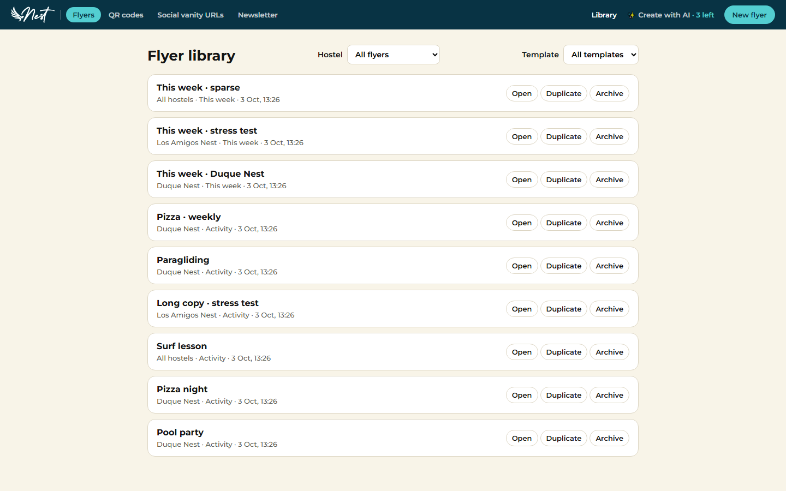 |
| `#/ai`, empty | 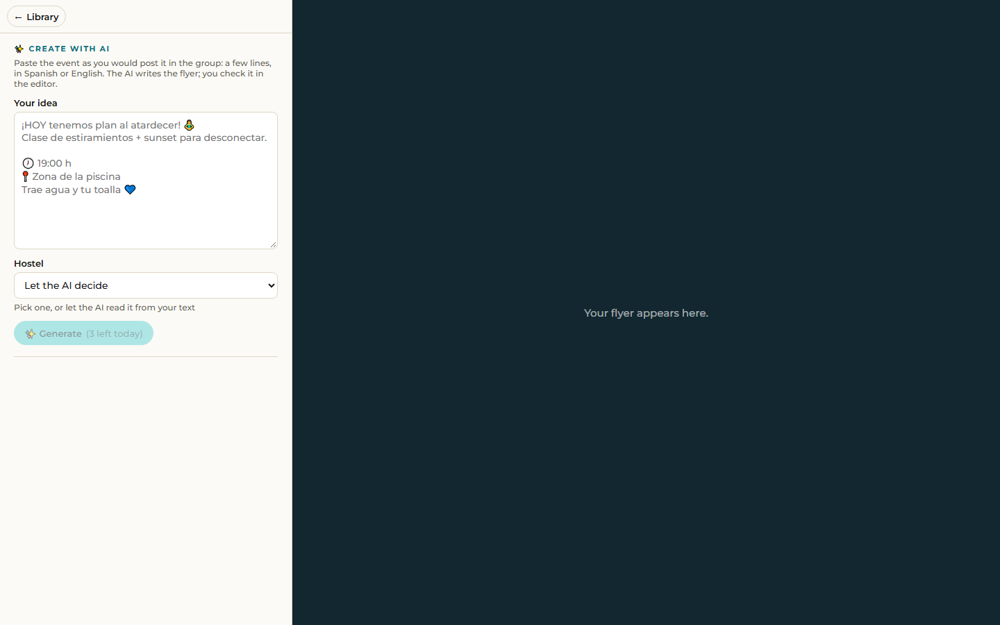 |
| `#/ai`, a flyer made | 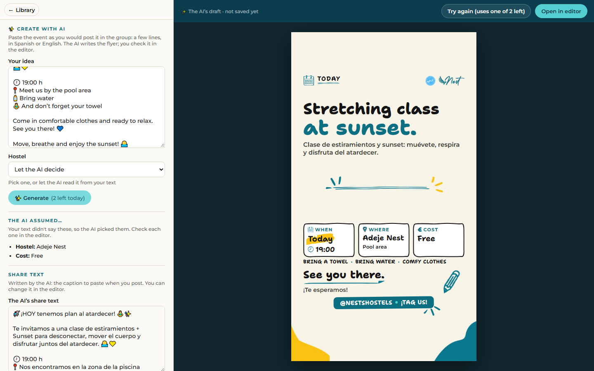 |
| The assumptions and the share text | 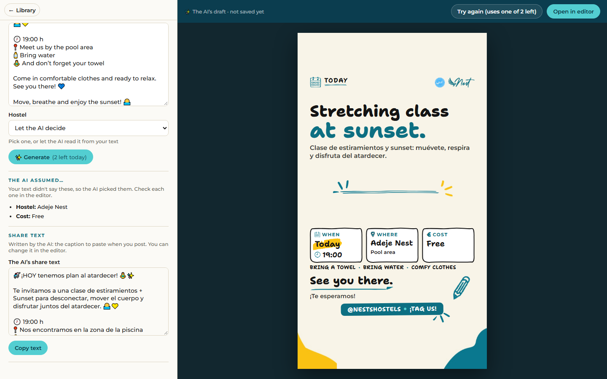 |
| The editor, with the "AI draft" note until the first save | 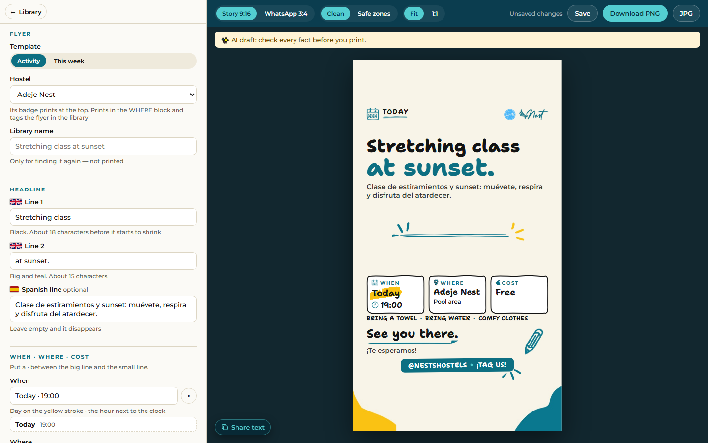 |
| "✨ Write with AI" in the Share text section | 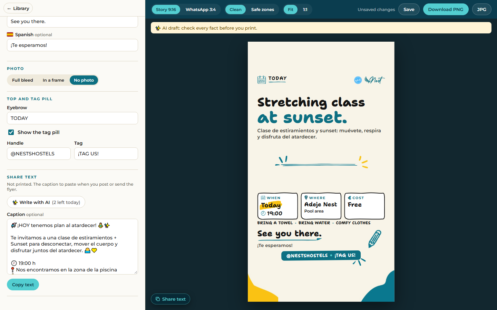 |
| The library, AI off: nothing of it shows | 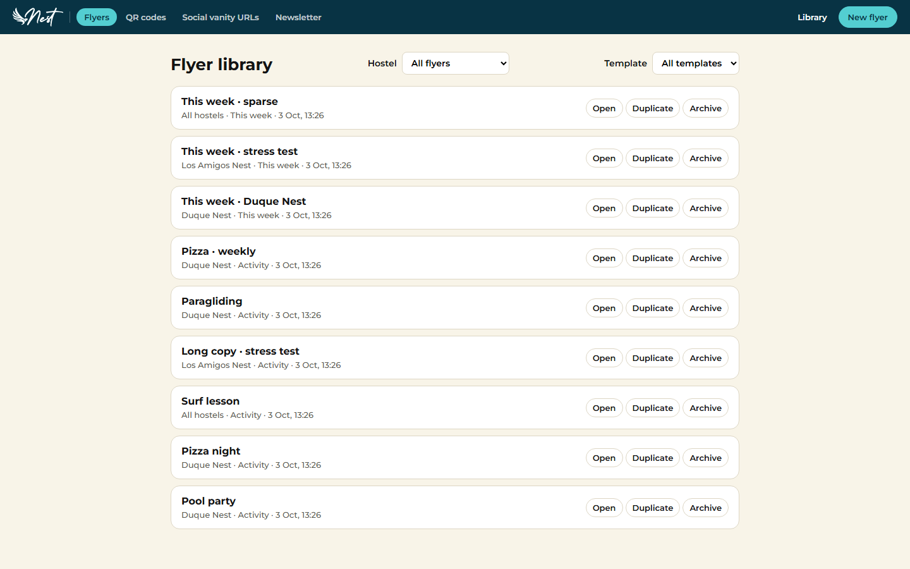 |
| The editor, AI off | 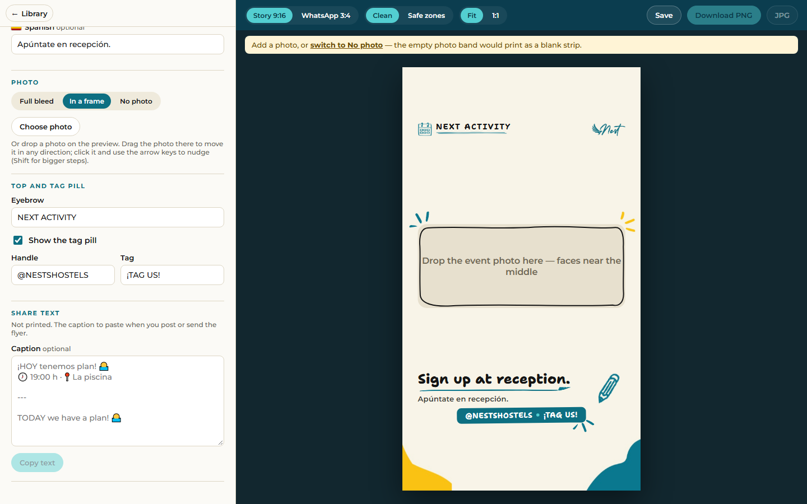 |
| Phone: the library, AI on ("✨ AI") | 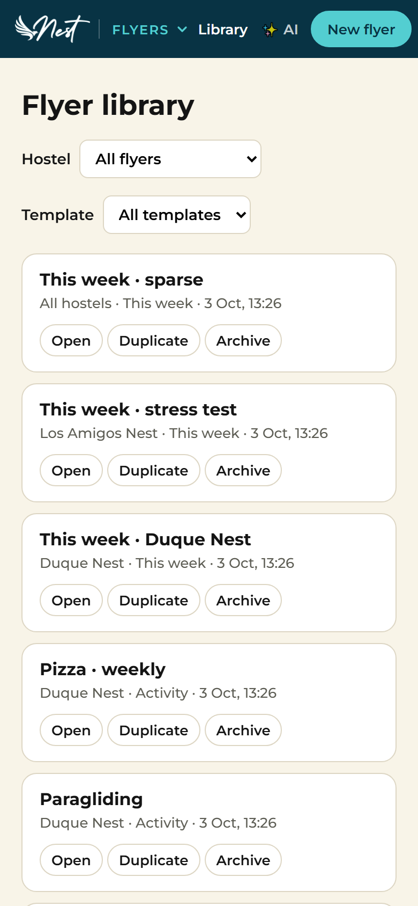 |
| Phone: `#/ai`, empty | 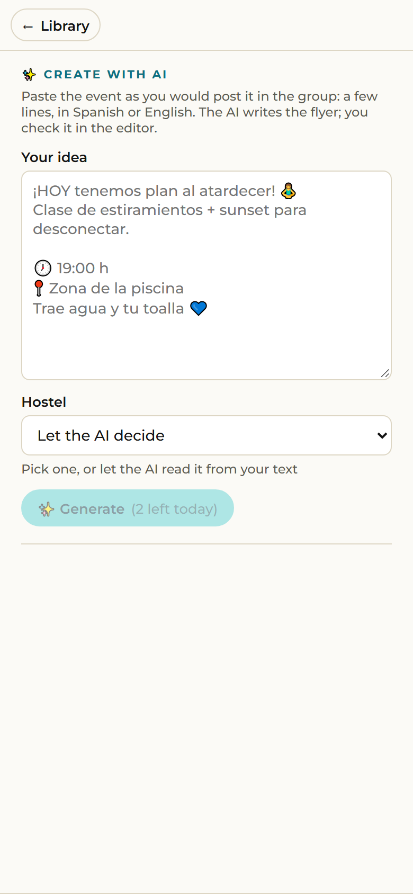 |
| Phone: `#/ai`, a flyer made | 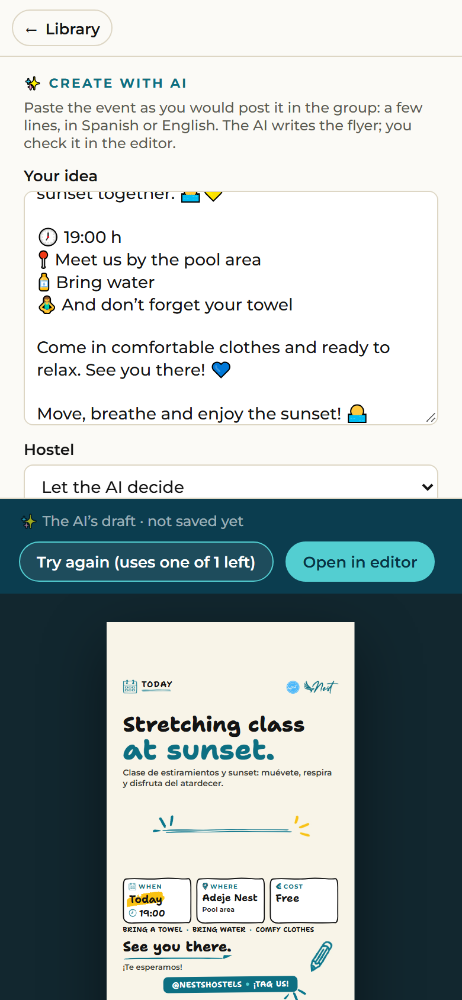 |
| Phone: the editor, AI draft | 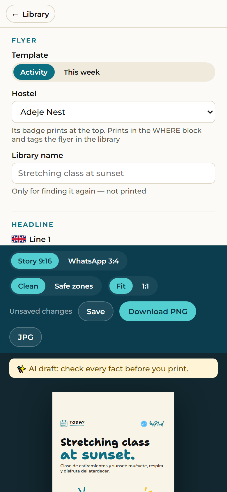 |
| Phone: "✨ Write with AI" | 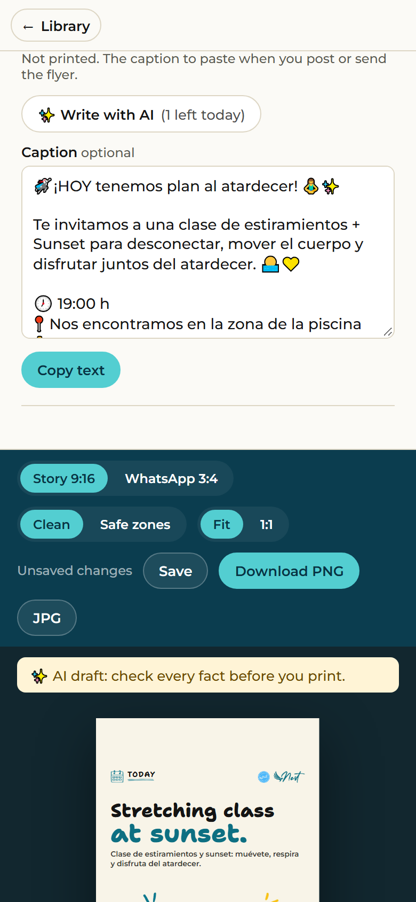 |

## Known limits

- **Two concurrent requests can both see `remaining: 1`.** The provider is never called under a store lock, so the
  count and the record are apart. Accepted for one anonymous actor and 3 a day.
- **`claude-haiku-4-5` retires no sooner than 2026-10-15.** It is a default: `AI_MODEL`, or `model` in `config.php`,
  changes it in one line.
- **IONOS's FastCGI time limit is unmeasured** until the first call there. If it is under 25 s, `timeoutMs` goes
  down to stay beneath it (`docs/deploy.md`, "The AI assistant").
- **Anthropic's first call after the answer's schema changes takes about 20 s** of the 25 s limit.
- **The client does not parse the routes' answers with zod** (it would bundle zod into the editor), so the contract
  is held on the server side only.
- **A long staff text takes two to three times as long:** 14 to 20 seconds for about a thousand characters, of the
  25 the app waits (*Follow-up*). The answer is twice as long, and the time follows it.

## Left open

What was open on 2026-10-04 is closed in *Follow-up*, below, which ends with what is left now.

## Follow-up: closing the feature (2026-10-05)

Branch `feat/ai-assistant-followup`, cut from `feat/ai-assistant` (`21cd090`). The brief is
`docs/prompts/ai-assistant-followup.md`. One commit per piece, each test first; nothing pushed.

### Artur's decisions (2026-10-05)

- **The review: "Do everything".** F1, F2 and F3, and also F4 and both things the review suspected but could not
  show.
- **Tag the live site's release** on the commit its own `api/config` names.
- **Look at the AI in a browser on both backends:** Node first, then the Laragon copy with its key set from `.env`.
- **The staff text** is his own: a day tour to Masca and Los Gigantes, 1,048 characters, with a price, a schedule,
  two phone numbers, and no hostel.

### The review's findings

| | What it was | What was done |
|---|---|---|
| **F1 (a)** | A ledger file no read can take answered 500 on `api/config`, and the editor renders nothing without that answer: the whole app was down for the rest of the month. Reproduced over HTTP on both backends before the fix | `status()` answers `enabled: false` and logs why, on both backends. The generation routes are not softened: a hidden AI never reaches them (`9828f09`) |
| **F1 (b)** | Node took any number as a token count and anything as the model's name, where PHP checked both. A count of 12.5 was written and then closed the month | A count is whole and not negative on both backends; Node takes the model only when it is a string. Three vectors per adapter (`e5cfa17`) |
| **F1 (c)** | `record()` wrote what it was handed, and a schema failure was a bare `ZodError` naming no file | Both Node drivers check a record before writing, proved by the shared repository contract. A damaged month's file is named, as `meta.json` is (`be2d855`) |
| **F2** | The model chooses an assumption's `field`. `"__proto__"` read `Object.prototype` and took the page down after the generation was spent | A `Map` lookup: a key no field has is shown as written (`a96452e`) |
| **F3** | Node read `schema/ai.json` before knowing the AI was off | Off returns before the read, as PHP does (`9e817fe`) |
| **F4** | The AI page kept its own copy of the editor's field names | `src/editor/fields.ts` holds them. The editor's labels come from it, and a test holds every key a brief can carry to a name (`a96452e`) |
| **The fence** | A staff text holding `"""` closed its own fence, and what followed read as outside the data | A run of three or more quotes inside the text is sent as two, on both backends. Two vectors (`bd166ac`) |
| **A key with a line break** | `AI_API_KEY="sk-…\n"` failed every call as a network error, and nothing named the cause | Both settings loaders refuse it, naming the setting and never its value (`3b5fcb6`) |

PHP needed no code for F1 (b) beyond the negative count, and none for F1 (c): it already checked the field types, and it
reads the ledger as a list without checking each record, so one bad record never closed a month there.

### The AI in a browser, with a real provider

**Not in Artur's own Chrome.** The Claude extension was not connected, so the look ran in the browser Playwright
drives: the installed Google Chrome 143, with its own profile. Each step was taken by hand and each screen read in a
screenshot. That browser answers a `confirm`, so the three dialogs were seen too.

The six real generations, all `gpt-6-luna`:

| # | Where | Call | Tokens in / out | Time |
|---|---|---|---|---|
| 1 | Node (`npm run dev`) | flyer | 4580 / 1213 | 14.7 s |
| 2 | Node | flyer, "Try again" | 4580 / 1414 | 16.4 s |
| 3 | Node | share text, from the editor | 2339 / 885 | 12.1 s |
| 4 | PHP (the Laragon copy, release `3f909ea91548`) | flyer | 4622 / 1175 | 13.7 s |
| 5 | PHP | flyer, "Try again" | 4622 / 1499 | 20.3 s |
| 6 | PHP | share text, from the editor | 2340 / 1096 | 12.2 s |

What it showed:

- **It works as a staff member would use it,** on both backends: the bar's count, the waiting state with every
  button that could send again disabled, a flyer, what the AI assumed, the share text in Spanish and English, "Try
  again" saying what it costs, the editor with its AI draft note until the first save, a save, a download on both
  canvases at 1080 × 1920 and 1080 × 1440, and the count going 3, 2, 1, 0.
- **The model did what the rules say with what the text leaves out.** No hostel: chain-wide, said in an assumption.
  No meeting place: no WHERE, and "add the meeting place before printing". It worked out "tomorrow" as Tuesday 6/10
  in the share text.
- **A long text is slow.** 14 to 20 seconds, against 6 to 9 for the short example: the answer is twice as long.
  Call 5 took 20.3 of the 25 seconds the app waits. `docs/deploy.md` now says so, and that `'effort' => 'low'` is
  the first thing to try if long texts start to fail.

What looked wrong, and was fixed, each test first:

- **With none left, the page said nothing.** A greyed "Generate (0 left today)" and not a word about midnight: the
  sentence showed only when a request was refused, which a disabled button never sends. It now stands under the
  button on the AI page and under "Write with AI" (`b586c5f`). Seen on the PHP copy afterwards.
- **"One of the 1 generations left today".** With one left, the question before a caption is replaced now says "the
  last generation", and the button "Try again (uses the last one)" (`693dc8a`). Seen on the PHP copy afterwards.

For Artur, not changed (the rules, or taste):

- **The flyer says "Every day" where the text also says "3 spot left tomorrow".** The model took the schedule line
  ("(daily): 9:20 am") for the flyer and put "tomorrow, Tuesday 6/10: 3 spots left" in the share text. If a text
  with both should print the day, that is one line in `ai/prompts/flyer.md`, or this text as an example with his
  correction.
- **While "Try again" runs,** the last result's assumptions and share text stay in the panel beside the waiting
  stage.
- **"Write with AI" on a saved flyer writes from the fields alone:** 870 characters against the 1,354 the generation
  wrote from the text, and the second phone number and the highlights are gone. The dialog asks first, and the idea
  is not kept with a saved flyer.
- **The red marks under English words** in the idea box are the browser's spell-check (this Chrome is set to
  Italian), not the app's.

Screenshots, in `docs/reports/ai-assistant/`:

| | Node | PHP |
|---|---|---|
| The library, the bar's count | 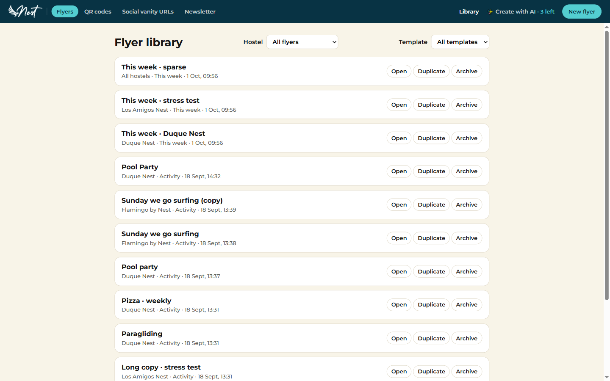 | 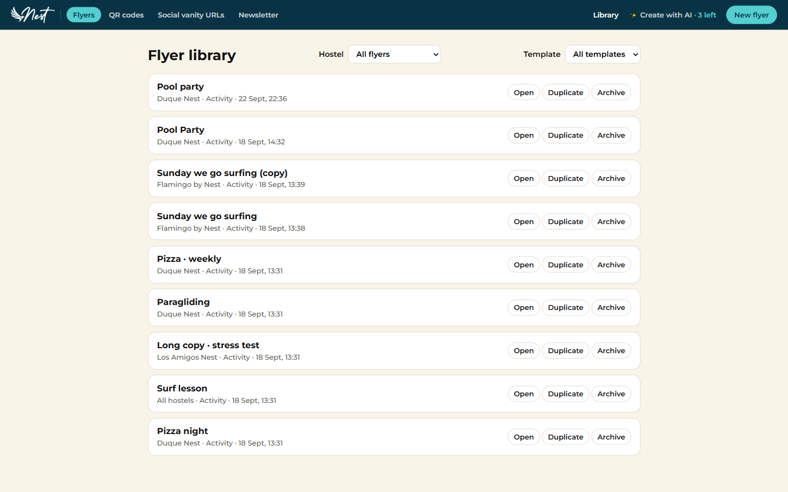 |
| Waiting |  | 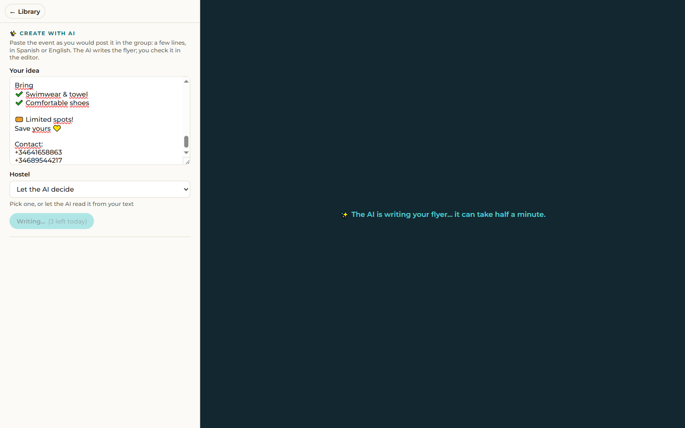 |
| The flyer | 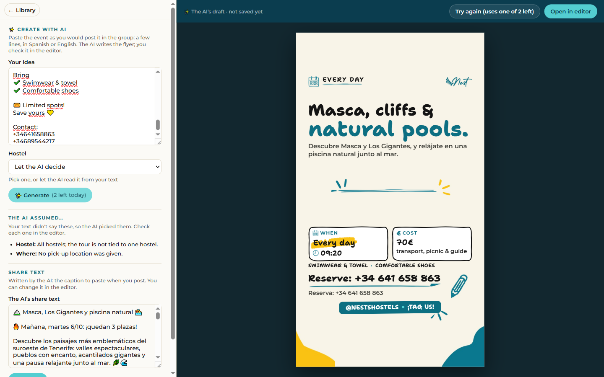 |  |
| After "Try again" | 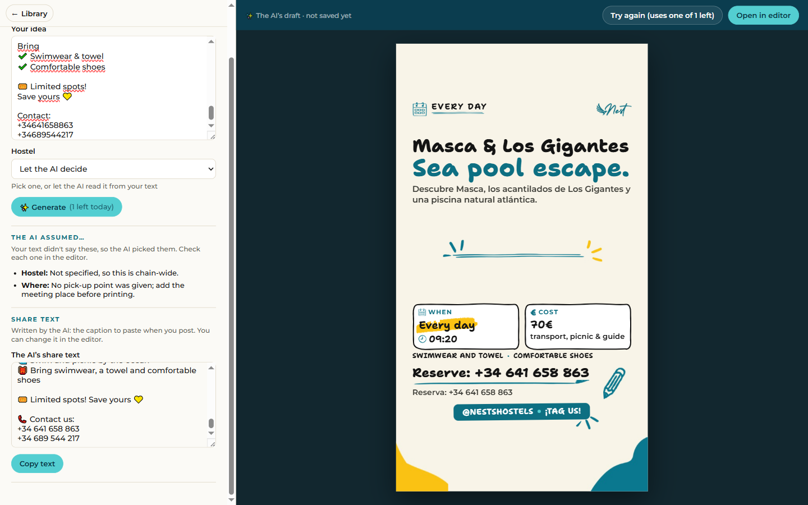 | 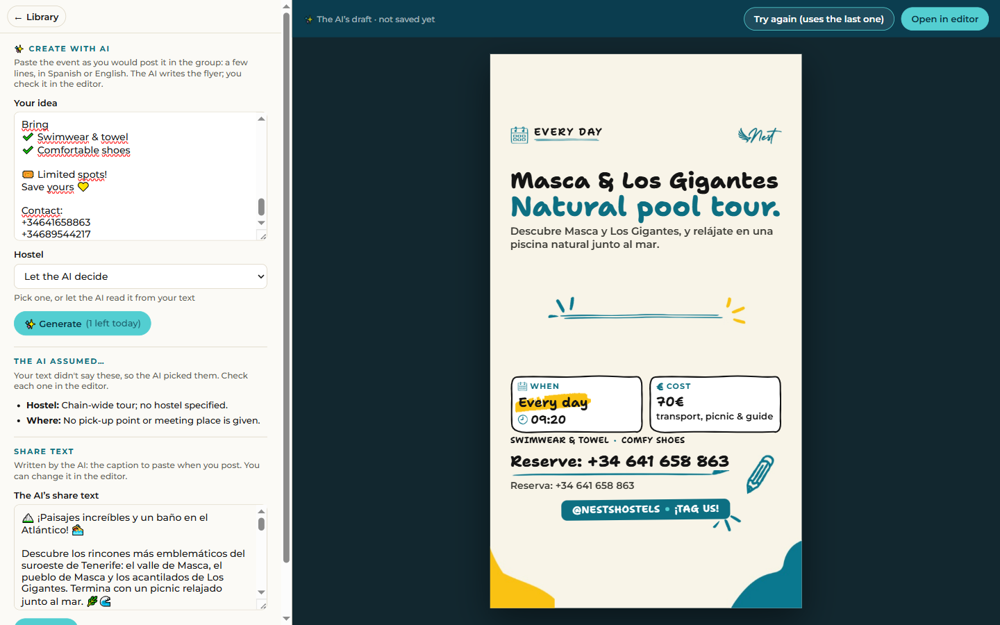 |
| The editor, AI draft | 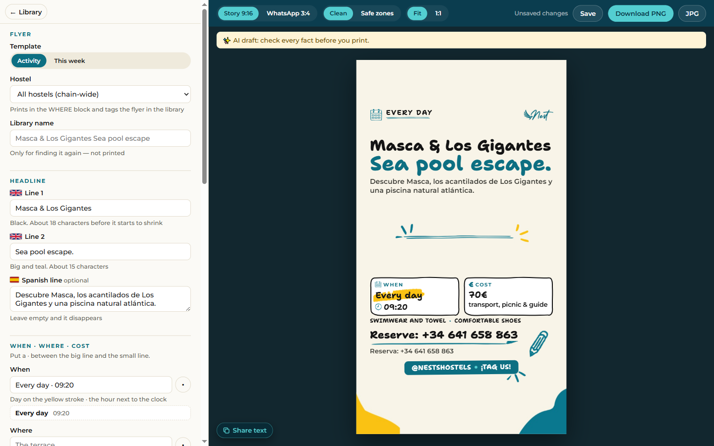 |  |
| The caption written | 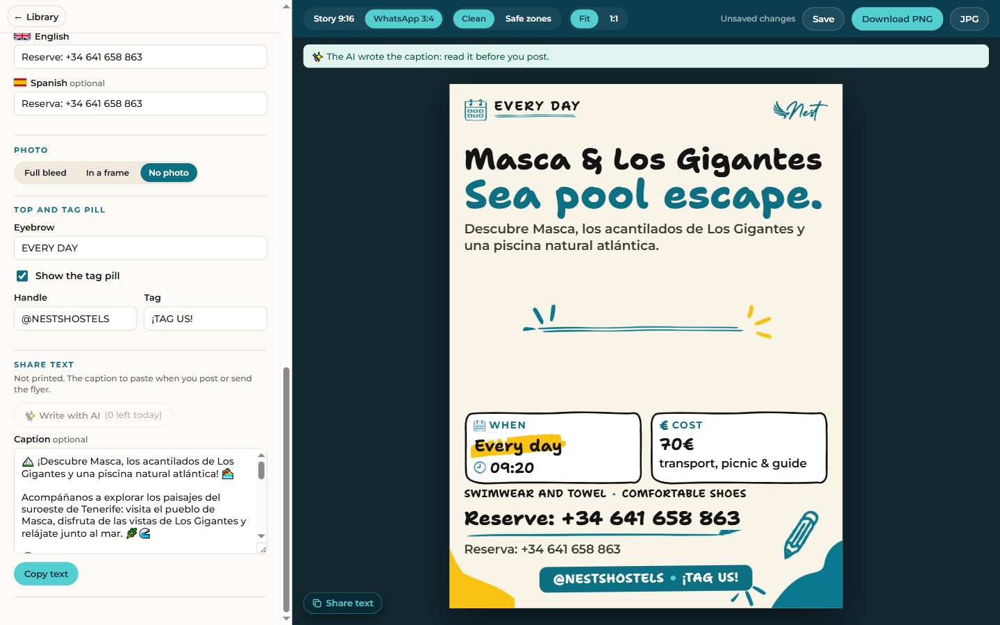 | 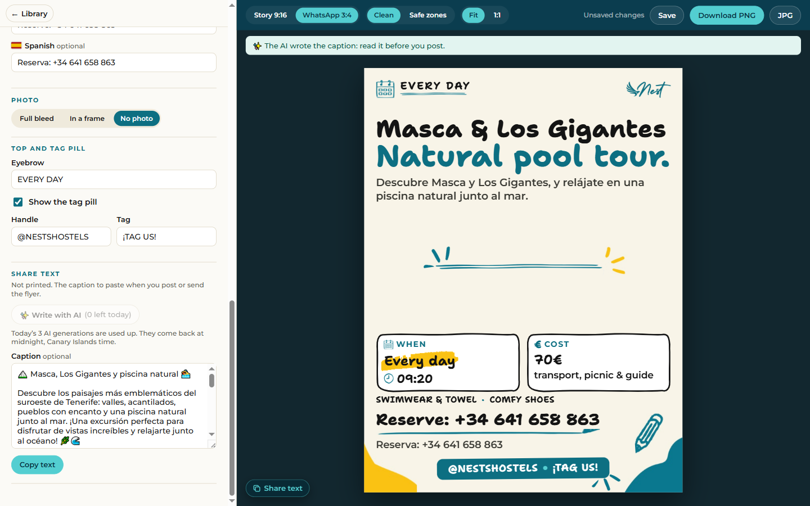 |
| The day used up | 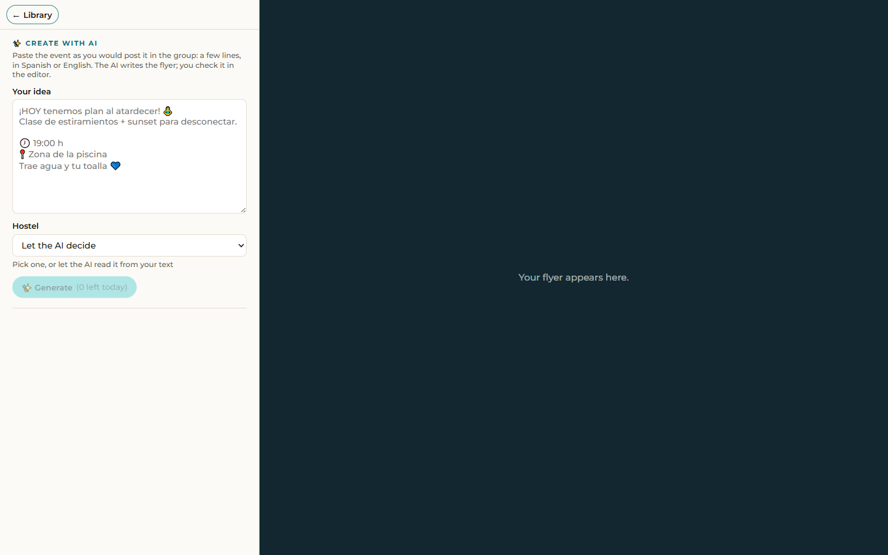 (before the fix) | 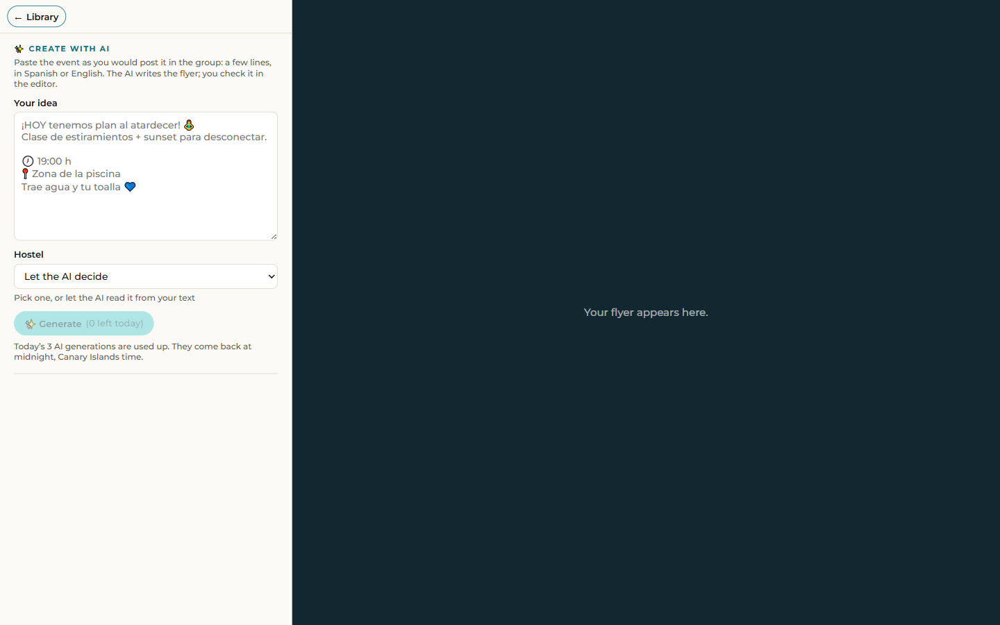 (after it) |
| A phone | 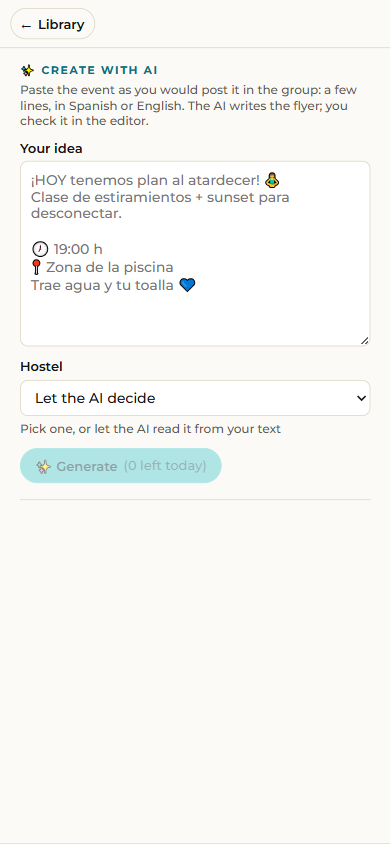 | 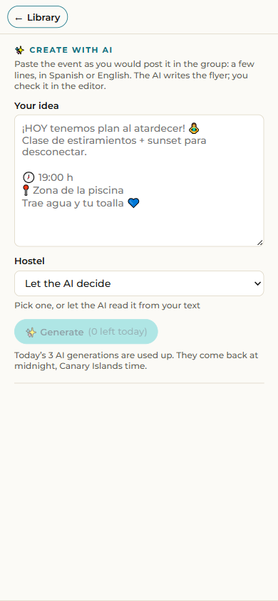 |

Also there: `real-node-4-assumptions-share.png`, `real-node-7-writing-caption.png`, `real-node-phone-2-library.png`,
`real-node-phone-3-editor.png`, `real-php-phone-1-result.png` and `real-php-phone-3-library.png`.

The look left one saved flyer on each: number 16 in the dev library and number 10 on the Laragon copy.

### The five known items

1. **PHP without curl answers `ai_failed`.** `HttpClientFactory` picks the client, as `ImageProcessorFactory` picks gd
   or imagick, and a host without curl gets one whose every call is a typed network failure: recorded, answered
   `ai_failed`, one log line naming curl (`630c32a`). Node needs no twin.
2. **A brief's blanks say nothing.** `flyerFromBrief` reads a field of spaces as an empty one and leaves out an extra
   or a week row with nothing in it (`9ee0265`). What the other optional strings did before:
   - the title was already trimmed;
   - a chip of one space collapsed in print but sat in its editor field;
   - a headline or ask line of one space is truthy to the renderer and printed as an empty line, and an ask of one
     space also replaced "Sign up at reception";
   - a week row of blanks did not print but opened as an empty row.

   The extras rule is one function, `printedExtras`, used by the flyer and by the brief. That touched `Flyer.tsx`,
   so the baseline was redone: 32 cases byte-identical.
3. **A missing price is "Ask at reception".** Four real calls through `npm run ai:smoke`, the stretching example
   held out (its text names no price and says "Te invitamos"):

   | Wording | `gpt-6-luna` | `claude-haiku-4-5` |
   |---|---|---|
   | "never `Free`: only a text that says it is free gets `Free`" | Ask at reception (8.4 s) | **Free**, with "the text says so" (22.5 s, its first call of the day) |
   | "Only the word itself or a price of 0 makes an event free: an invitation says nothing about the price" | Ask at reception (7.2 s) | Ask at reception (6.2 s) |

   Haiku read the invitation as a price. The line in `ai/prompts/flyer.md` is the second one (`34a010d`). The first
   few-shot example still shows a text with no price answered "Free", which was Artur's own answer when asked; its
   brief stays as posted.
4. **The stretching example's notes** say its ask was a one-off (`49550e5`).
5. **The `fetchJson` test has room:** 20 s for the call and 30 s for the test (`730c82b`).

### Releases

- **`npm run deploy:update -- <deploy folder>`** (`b03fd3f`): it refuses a folder that is no deployment, backs it
  up, builds the release, copies it over the folder without deleting anything, and tags it. When the copy's root
  `.htaccess` is not the last release's own (a lock pasted in), the backup keeps it and the run says so.
  `tests/cross/update-drill.test.ts` rehearses it on a served PHP stage: the app names the new release with nothing
  missing or changed, and the library, the photos, `config.php` and a file nobody shipped are byte for byte what
  they were.
- **`npm run deploy:tag -- <deploy folder | site address>`** (`18ea994`): the annotated tag `release/<id>` on the
  commit a release names, with the site and the day in its message. It refuses a release built from uncommitted
  changes, one that names no commit, a commit this checkout lacks, and an id already tagged elsewhere. A tag is
  never moved, and nothing is pushed.
- **A build names its commit, whatever tags exist** (`a19c2b9`). `release.json`'s `commit` was
  `git describe --always --dirty`, which answers with a tag's name once an annotated tag is reachable: the release
  tags would have turned every later release's commit into `release/<id>-3-g1490956`.
- **The tags made:**

  | Tag | Commit | Where it runs |
  |---|---|---|
  | `release/d1f7ddb40170` | `0df2709` | `https://nestpass.ai/activities/`, since 2026-10-01 |
  | `release/8b9c8556afa1` | `1490956` | the Laragon copy, 2026-10-04 to 2026-10-05 |
  | `release/3f909ea91548` | `1253633` | the Laragon copy, since 2026-10-05 |

- **The Laragon copy** was updated by `deploy:update` itself: backup
  `backups/nest-flyers-php-2026-10-05-20-16-13` (9 flyers, 6 photos, `config.php`), then release `3f909ea91548`,
  434 files, 3.90 MB. Its `api/config` names that release with nothing missing or changed and still lists 9 flyers.
  Its AI was off when the session began (the `apiKey` line had been commented out on 2026-10-04); the key was set
  again from `.env` by a script that printed nothing, and it is on.
- **Two builds of one commit get two ids,** as the brief said: a second `npm run build:php` at `1253633` gave
  `76fc4053acc7`. Three files differ, all composer's (`vendor/autoload.php`, `autoload_real.php`,
  `autoload_static.php`): its autoloader suffix is random. `"autoloader-suffix"` in `php/composer.json` would make
  the id repeatable. Not done: it changes what an id means.

### Rulings

Each was mine, with its cost if wrong; the session ledger has them in full.

- **`node-ai` runs on the JSON driver,** as `php-ai` does, so the contract suite can damage the ledger's file on
  both backends. SQLite's ledger over HTTP stays with the render suite's `ai` project.
- **A token count is whole and not negative on both backends,** so the adapters hand the ledger only what its schema
  takes.
- **"`record()` refuses what the schema refuses" is in the shared repository contract,** so SQLite's `record()` checks
  too.
- **A field of spaces is read as empty, not as "use the default".** `""` already means "print nothing" in a brief
  written by hand.
- **The used-up sentence is the catalogue's `ai_quota` message,** imported into the client from
  `src/shared/errors.ts`: one home for the words, 0.7 KB in the editor's bundle, and no zod.
- **A build is dirty when anything outside `docs/` differs from its commit,** a new file included (`1253633`). The
  plan counted every untracked file. During the session another session of Artur's saved an example under `docs/`,
  and that rule would have refused every tag for a file no release can hold: an example reaches a build only
  through `schema/ai.json`, which is tracked, and the build refuses stale generated files.
- **The Chrome look ran in Playwright's Chrome,** not the extension's (above).
- **One commit's message was reworded** by amending it and replaying the two after it: PowerShell had dropped the
  double quotes that were its point. The trees did not change.

### The gates

One sequence on 2026-10-05, with a real key in `.env`, at `b03fd3f`:

| Gate | Result | On 2026-10-04 |
|---|---|---|
| `npm run gen` | every generated file up to date | the same |
| `npm run typecheck` | 0 errors | 0 |
| `npm test` | 27 files, 404 tests passed | 23 files, 337 tests |
| `npm run test:contract` | 38 files, 359 tests passed (7 files and 215 tests skipped by project) | 37 files, 353 tests (7 and 212) |
| `npm run test:php` | 743 tests, 9630 assertions, 37 skipped (the same 37) | 726 tests, 9589 assertions |
| `npm run test:render` | 117 passed, 1 skipped (the opt-in baseline) | 114 passed |
| `npm run test:php-smoke` | 2 passed | 2 passed |
| `baseline.spec.ts` | 32 cases byte-identical against a capture from before `Flyer.tsx` changed | not redone |

After the one code change that followed (`1253633`, `scripts/git.ts`): typecheck 0, `npm test` 27 files and 405
tests, and the `cross` project 4 files and 20 tests.

- **No test touches a provider.** The ten real generations were the six above and the four of `npm run ai:smoke`.
- **Every fix was red first,** for its stated reason. The contract case for F1 was run against the unfixed services
  by stashing the two fixes, since the unit fixes came first: `api/config` answered 500 on both backends.
- **Three tests were green from the start,** as pins of what already held: a ledger file that is not JSON on each
  backend, and PHP counting past a record with a count of 12.5.

### What is left

- **Every commit since 2026-09-28, and every tag, exists only on this machine.** `main` is fast-forwarded to this
  branch, locally. The push is Artur's.
- **The live site** runs the release from before the AI. In this order:
  1. `npm run build:php`, upload the release (`docs/deploy.md`, *Updating to a new release*), then
     `npm run deploy:tag -- https://nestpass.ai/activities/`;
  2. add the `ai` block to its `config.php`, never before the new release is up: an older release answers 503 to it;
  3. `npm run ai:smoke -- --to https://nestpass.ai/activities/`, once. It spends one of the day's 3, and its seconds
     are the first measure of the host's time limit.
- **The live site still answers without a password** (`allowPublic`, seen again on 2026-10-05).
- **`release/php/` holds build `76fc4053acc7`,** which is on no site: step 1 builds again.
- **Left as they are, on purpose:** two concurrent requests can both see `remaining: 1`; `claude-haiku-4-5` retires no
  sooner than 2026-10-15; `timeoutMs` stays at 25 s until the first live call; the client does not parse answers
  with zod; an empty share text still passes.
