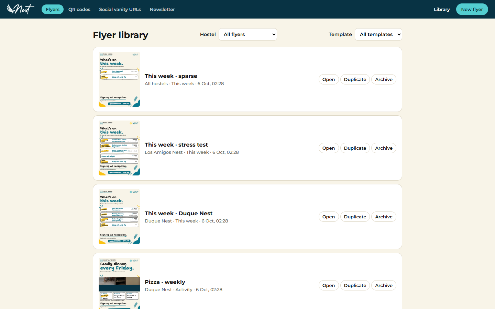
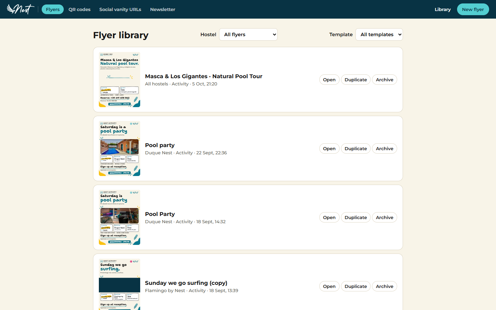
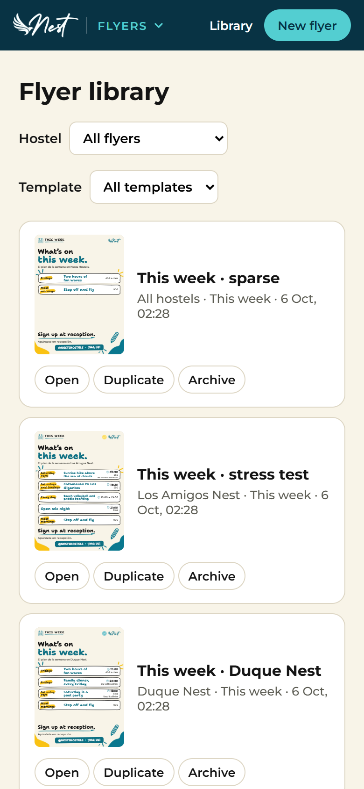
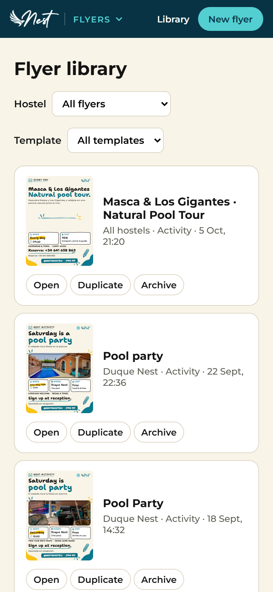
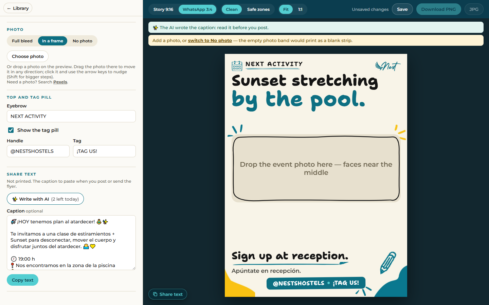
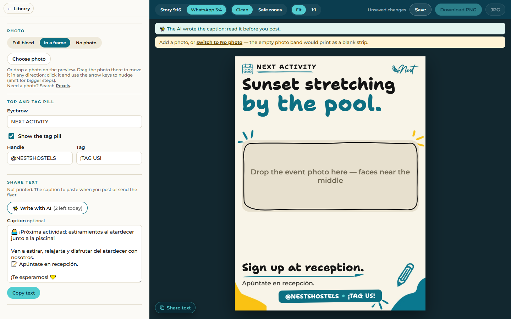
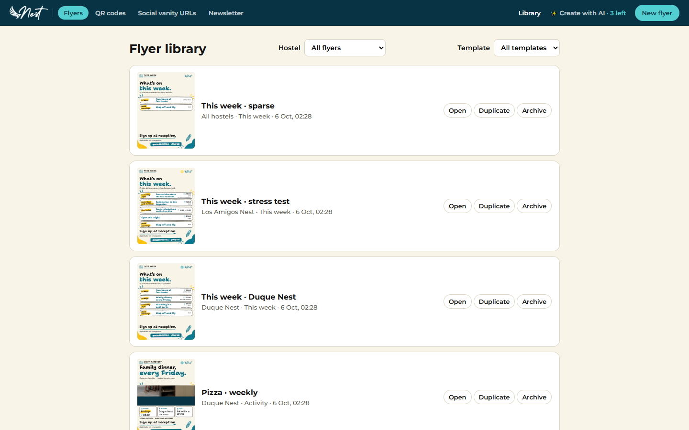
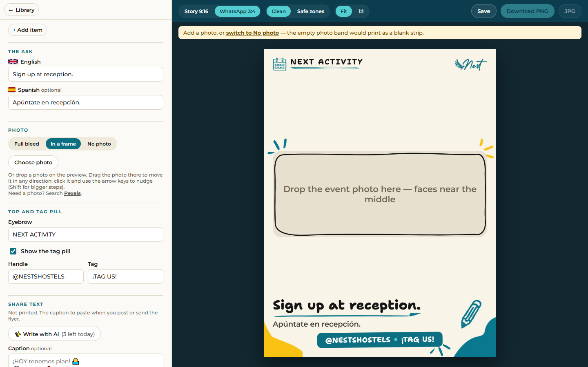

# AI feature switches, and four changes to the editor and the library

Branch `feat/ai-feature-switches`, cut from `main` (`1f4b07e`) on 2026-10-06. The brief is the one pasted on
2026-10-05 ("AI feature switches, and four changes to the editor and the library"). One commit per piece, each
test first; nothing pushed.

## What it is

Staff are to try the AI on the live site, starting small. Only "Write with AI" (a flyer's share text) runs there;
"Create with AI" (a whole flyer from a staff text) stays on Artur's machine. The AI had one switch for both. Now
each feature has its own, and the same trial brings four changes staff will meet: a plainer placeholder, WhatsApp
shown first, a line about Pexels, and a picture of each flyer on its library card.

## Artur's answers (Part 0, 2026-10-05)

| Question | Answer |
|---|---|
| With no setting, which features run? | **None until named.** A key alone runs nothing |
| The daily cap | **A setting, 3 by default**, refused above 20 (the bound is in the code) |
| "WhatsApp as default" | **The screen only.** The export API's default stays `story` |
| The library's pictures | **WhatsApp, always** |
| The idea box's placeholder | "Tomorrow at 19:00 we have a sunset stretching class by the pool. Bring water and a towel." |
| The Pexels line | "Need a photo? Search Pexels." (the word Pexels is the link) |
| The card | **Today's row, with a thumbnail at its left** |
| The Laragon copy | its `features` set by a script that prints nothing; **left share only** |

Three of them differ from what the brief proposed: "none until named" (it proposed both features with no setting),
the cap as a setting (it left that open), and the placeholder in English (it proposed the sentence in Spanish).

## What was built

### Part 1: each AI feature has its own switch

| | Node (`.env`) | PHP (`config.php`, the `ai` block) |
|---|---|---|
| The features that run | `AI_FEATURES=share`, or `flyer,share` | `'features' => ['share']` |
| The daily cap | `AI_DAILY_LIMIT=3` | `'dailyLimit' => 3` |

- **None until named.** Unset, empty or `[]` runs nothing: a provider and its key are no longer enough. A name no
  feature has is refused by the setting's name, never its value, on both backends. `AI_ENABLED` / `enabled` is
  still the switch for all of it.
- **The policy decides, in one place.** `enabled()` became `runs(feature)`. "The AI is on" is derived as "some
  feature runs", so the two cannot disagree. A feature that is off answers `ai_off` where the whole AI does: after
  the body and the write guard, before the actor, the body's shape, the count and the provider. Nothing is read,
  counted or recorded.
- **`api/config` lists the features that run** (`features`, on the enabled answer, never empty). The schema is
  strict, so both backends, the contract suite and `docs/api-contract.md` changed in one commit.
- **The client shows only what is on,** through `aiFor(ai, feature)` in `src/shared/ai.ts`. `App.tsx` is the one
  place that asks. Without `flyer` there is no "Create with AI" and `#/ai` is the library; without `share` there
  is no "Write with AI".
- **`npm run ai:smoke` refuses before spending** when the feature it would call is off, on a site (`--to`) and on
  this machine's own settings. It names a site that lists no features as a release from before the switches.
- **The cap is a site's own setting:** 3 unless set, a whole number from 1 to 20. Still one counter for both
  features.

### Part 2: three small changes

- **The placeholder** of the idea box is two plain sentences. The old one, an emoji and a line per fact, read as a
  form.
- **WhatsApp is the canvas a viewer who never chose sees** (`DEFAULT_CANVAS`, beside the `CANVASES` registry): the
  editor, where a stored choice still wins, the AI page's preview, and the library's pictures. The export API and
  the render page keep `story` for a request that names no canvas.
- **The Pexels line** sits under the photo buttons and opens in a new tab, so it never costs a draft.

### Part 3: a picture of each flyer on its library card

- **It is the flyer itself.** `src/editor/FlyerThumb.tsx` mounts the same `<Flyer>` on the default canvas at its
  true size, scales it with a transform and prepares it as an export is. A test holds its fitted sizes to the
  export's. No second renderer and no stored thumbnail.
- **Each card asks for its own flyer** (`GET api/flyers/:id`) when it nears the screen. The contract and both
  backends are unchanged, and the list is still six text fields.
- **A fixed box:** 120 × 160 px, and 96 × 128 at phone width, whether the picture waits, shows or could not load.
- **Decoration:** inside the card's own link, `aria-hidden` and `inert`. The link is still named by the title,
  nothing in the flyer takes focus, and a click on the picture opens the flyer.
- **Latest answer only:** an answer that arrives after its card has gone is dropped.

## How "one feature off" is proved, with no new server

The brief asked for a decision. The contract suite's `node-ai` and `php-ai` each run one server with every feature
named, and they stayed that way.

1. **The settings**, on both loaders, by one table: `tests/fixtures/ai-settings.json`, replayed by Vitest and by
   PHPUnit.
2. **Each service**, with a policy that runs one feature: the other answers `ai_off` before its body is read, the
   provider is never asked, and nothing is counted or recorded.
3. **Each backend's whole app, in process**, with each feature switched off in turn: `tests/unit/ai-app.test.ts`
   through `createApp` on Node, `php/tests/BootstrapTest.php` through the kernel on PHP. Both are built from the
   real settings and composition, and both loop over the generated list of features.
4. **The HTTP contract suite** keeps the two states it has servers for: off, and every feature on.
5. **The Laragon copy**, set to the share text alone, over real HTTP on Apache (below).

## Findings along the way

- **A refused `config.php` logs its reason to the host's own PHP error log, not to `data/php-errors.log`.** The
  troubleshooting table said the data folder. Reproduced on a test stage: the app answered 503, the data folder had
  no log, and the line was in PHP's default log: `config.php is not valid, so the API answers 503 until it is
  fixed: ai.features must be null or a list of: flyer, share`. PHP's log moves into the data folder only once
  `config.php` has been read, and a refused file is never read that far. `docs/deploy.md` now says so. Changing
  where it is logged is Artur's to decide.
- **A release from 2026-10-03 to 2026-10-05 has one switch for both features.** Going back to one with the key in
  place would run "Create with AI" on the host. `docs/deploy.md`, *Rolling back*, says to add `'enabled' => false`
  first.
- **The tests that run git timed out at vitest's 5 s** in three full runs of `npm test` out of five, a different
  test each time, right after a render suite. Alone each takes one or two seconds. They have 30 s now, the remedy
  `copy.test.ts` got on 2026-09-30.
- **Photos are the weight of a picture.** A flyer's own data is 2 to 4 KB; its stored photo is 0.2 to 1.3 MB. With
  the sample library on a desktop window, six cards asked for their flyers on load and one 1.3 MB photo came with
  them; on a phone, five cards. A small copy of each photo would cut that, and needs both backends and a backfill
  of the photos already stored. Not built: it is Artur's to decide.

## The review

One fresh-context review of the whole branch, by another agent, once the pieces were committed. It found no way
for a feature that is switched off to run, be spent, be recorded or be shown, on either backend. It found one
Important point and ten Minor ones. Re-graded by what a person would meet, seven were fixed, each with a test that
failed first:

| What it found | What was done |
|---|---|
| The test "a picture that arrives after its list has gone" could not fail: there the card is gone, and React drops the answer by itself | A new test keeps the card and changes its flyer under it, with the old answer landing last. With the guard removed it failed ("Before the save" drawn over the newer flyer); with it, it passes. The old test also had a race, now closed: it could change the filter before the card had asked |
| `aiFor` read `features` without checking it was there, in `App`'s render: a backend older than the client gave a blank page | Re-graded Important: while a release is uploaded, its new files answer beside the old ones. `aiFor` now reads any answer it does not know as "no AI", and a missing `ai` block is off. Two browser tests, one per older backend |
| Nothing pinned PHP's "no feature named reads no bundle" | `BootstrapTest` removes `schema/ai.json` and expects the app up with the AI off. It fails with the clause removed |
| The first library test waited for the sixth card without scrolling to it | It scrolls first |
| A test's name said "counts down" and never clicked | Renamed to what it checks |
| The sample's test did not pin `'features' => []` | It does, and `'dailyLimit' => null` |
| "Or drop a photo on the preview" now followed the Pexels line, so its "Or" answered the wrong thing | The Pexels line sits after the photo's own help |
| A title in one unbroken run overflowed a phone's card beside the picture | The card's text wraps anywhere; the phone test has such a title |
| A comment in `AiPolicy.php` still named the shared cap | Corrected |

Left as it is, for Artur:

- **Node reads a few spellings PHP refuses.** `AI_DAILY_LIMIT=1e1`, `0x10`, `2.0`, `+5` and `" 7 "` are numbers to
  Node; PHP takes whole numbers alone. `AI_FEATURES=share,,flyer` drops the empty item; PHP refuses `['share', '']`.
  Neither side repeats a value in a refusal. `AI_TIMEOUT_MS` has read numbers the same way since 2026-10-04.
- **Outside this branch:** the Node start-up line prints `AI_MODEL` as typed, so a key pasted on that line would be
  printed to the console; and with the AI on, a missing `schema/ai.json` makes PHP's `api/config` answer 500. Both
  were so before.

## Rulings

Each was mine, with its cost if wrong.

- **`runs(feature)` replaces `enabled()` on the policy.** One method per question. If wrong: a rename on a
  three-method interface, two implementations and their test doubles.
- **No new contract-suite server.** If wrong: the suite could reconfigure its running AI servers (rewrite
  `config.php` on PHP, swap the app on Node); the HTTP layers that would add are the ones "the whole AI off"
  already covers on every backend.
- **Each card fetches its own flyer, with no queue and no cache.** The screen bounds how many ask at once. If
  wrong: a long library scrolled fast asks for many flyers and photos; the cure is pagination or a small photo copy.
- **`inert` on the picture, inside the card's link.** The test decided: in Chrome the click passes through to the
  link, so no fallback was needed.
- **The AI page's preview is always the default canvas,** not the editor's remembered choice: the brief's words,
  and that page has no canvas switch.
- **An empty `features` list means none, never an error,** on both backends: it cannot turn anything on.
- **The cap's lowest value is 1.** Zero would mean "off", which is `enabled`'s job.
- **The settings table has rows that are one backend's alone** (spaces and a stray comma in `.env`; a string or a
  keyed array in `config.php`): an env line and a PHP array cannot spell the same mistakes.
- **The default canvas was named with its old value first.** The browser specs cannot load before the constant
  exists, so it went in as `story`, the pinned tests were seen to fail on behaviour, and then it became `whatsapp`.
- **The git tests' timeout** is outside the brief. It was changed because a gate that fails one run in two cannot
  be called green.
- **The Pexels line sits after the photo's own help,** not straight under the buttons: the review's point about
  the "Or". It is still under the buttons, and the words are the ones Artur approved.
- **The look ran through a script,** in the installed Google Chrome, not by hand: the same walk on both backends,
  every screen read in a screenshot.

## The look in a real browser

**Not in Artur's own Chrome.** The Claude extension was not connected, so the look ran in the installed Google
Chrome 143 driven by Playwright, with its own profile. A script walked the same path on both backends (the library,
the `#/ai` address, a new flyer's editor) in a desktop window (1440 × 900) and a phone-sized one (390 × 844), and
every screen was read in a screenshot.

- **Node** ran the built app on a throwaway data folder with the nine samples and the fake provider: nothing was
  spent.
- **PHP** was the Laragon copy (`https://nest-flyers-php.test/`, Apache), on the new release, with the real
  provider and Artur's real library.

| What was looked for | Node | PHP |
|---|---|---|
| **Share only:** no "Create with AI" anywhere, `#/ai` opens the library | yes: no entry on the bar, `#/ai` → `#/` | yes, the same |
| **Share only:** "Write with AI" writes a caption and counts down | 3 → 2 → 1 (the fake) | 3 → 2 → 1, two real captions |
| **Both on:** the bar offers "Create with AI" with its count | "Create with AI, 3 left today" | the same |
| **Both on:** a flyer from an idea, on the WhatsApp canvas | yes (the fake), `data-canvas="whatsapp"` | the page opens; no real flyer was generated |
| **The cap as a setting** | `AI_DAILY_LIMIT=5`: `api/config` says `limit: 5` | left at 3 |
| **The library's pictures** | 6 of 9 cards asked on load on desktop, 5 on the phone | 6 of 10 on desktop, 5 on the phone |
| **The picture's box** | 120 × 160, and 96 × 128 on the phone; no sideways scroll | the same |
| **The WhatsApp default** | "WhatsApp 3:4" pressed on a new flyer | the same |
| **The placeholder** | the new sentence, in the idea box | the same |
| **The Pexels line** | "Need a photo? Search Pexels.", `target="_blank"` | the same |

**The three real generations,** all on the Laragon copy set to the share text alone:

| # | Call | Time |
|---|---|---|
| 1 | "Write with AI" in the editor, desktop | 5.4 s |
| 2 | "Write with AI" in the editor, phone | 3.7 s |
| 3 | `npm run ai:smoke -- --share --to https://nest-flyers-php.test/` | 5.3 s |

After them the copy said `remaining: 0`.

**A flyer refused there, three ways, with nothing spent** (`api/config` still said 3 left afterwards):

- `POST api/ai/flyer` with the write header: 404, "The AI is switched off on this site."
- The same without the header: 403, "Missing X-Nest-Flyers header." The write guard still comes first.
- `npm run ai:smoke -- --to …` stopped at `api/config`: `This site does not run "flyer": its settings name share
  alone ('features' in config.php's ai block; AI_FEATURES on a Node server). Run it with --share for the share text.`

**"None until named", seen on a real deployment.** Right after `deploy:update` the copy had its provider and its
key and no `features`: `api/config` said `ai: {"enabled": false}`. With `['flyer', 'share']` named, both came back.

**What the photos weigh,** on the Laragon copy's first screen: four photos on desktop (794, 239, 1,086 and
1,300 KB: 3.4 MB), three on the phone (2.1 MB). The browser keeps them afterwards.

| | Node | PHP |
|---|---|---|
| The library, share only |  |  |
| The library on a phone, share only |  |  |
| "Write with AI", the caption written |  |  |
| The library, both features on |  |  |
| The editor: WhatsApp first, the Pexels line |  |  |

Also there: `node-both-desktop-ai-flyer.png` (a flyer from an idea, on the WhatsApp canvas),
`node-both-phone-ai-page.png` (the placeholder), `php-both-desktop-ai-page.png`, `php-both-phone-library.png` and
`php-share-only-phone-editor-share.png` (a real caption on a phone).

## The release

- `npm run deploy:update -- A:\serverpath\laragon\nest-flyers-php` put release **`2ad58f28364e`** on the Laragon
  copy: 434 files, 3.91 MB, built from `2c9e5f8`, nothing deleted. Its `api/config` names that release with
  nothing missing or changed.
- The backup taken first is `backups/nest-flyers-php-2026-10-06-01-25-07`.
- The tag `release/2ad58f28364e` is on `2c9e5f8`. Not pushed.
- **The copy is left with the share text alone** (Artur's answer): its `ai` block says `'features' => ['share']`,
  set by a script that printed only yes or no. Today's three generations there are used.
- **This machine's `.env`** got one line, `AI_FEATURES=flyer,share`, appended by a script that printed nothing of
  the file: `npm run dev` runs both features, as before.

## The gates

One sequence on 2026-10-06, on the tree of `2c9e5f8`, with a real key in `.env`:

| Gate | Result | On 2026-10-05 |
|---|---|---|
| `npm run gen` | every generated file up to date | the same |
| `npm run typecheck` | 0 errors | 0 |
| `npm test` | 28 files, 448 tests passed | 27 files, 405 tests |
| `npm run test:contract` | 38 files, 359 tests passed (7 files and 215 tests skipped by project) | the same |
| `npm run test:php` | 781 tests, 9,779 assertions, 37 skipped (the same 37) | 743 tests, 9,630 assertions |
| `npm run test:render` | 130 passed, 1 skipped (the opt-in baseline) | 117 passed |
| `npm run test:php-smoke` | 2 passed | 2 passed |
| `baseline.spec.ts` | 32 cases byte-identical against a capture of `1f4b07e`, taken before anything changed | 32 |

- **No test touches a provider.** The three real generations are the ones above.
- **Every piece was red first,** for its stated reason. Where the code was already right and a test was added to
  hold it (the guard in the library's pictures, PHP's "no feature named reads no bundle"), the code was broken on
  purpose to see the test fail, then put back.
- **Two tests were green from the start,** as pins: the PHP smoke test's check of the picture, and the sample's
  `'features' => []`.
- **One flake, once:** `ai.spec.ts`'s first test did not find the bar's entry within 5 s on a cold server start
  (7.3 s for the test), then passed in every run after. It was there before this branch and was not changed.

## What is left

- **Nothing is pushed.** Every commit since 2026-09-28 and every tag exists only on this machine. `main` is
  fast-forwarded to this branch, locally.
- **The live site** runs the release from before the AI (`d1f7ddb40170`). In this order:
  1. `npm run build:php`, upload the release (`docs/deploy.md`, *Updating to a new release*), then
     `npm run deploy:tag -- https://nestpass.ai/activities/`;
  2. add the `ai` block to its `config.php` with `'features' => ['share']`, never before the new release is up: an
     older release answers 503 to it;
  3. `npm run ai:smoke -- --share --to https://nestpass.ai/activities/`, once. It spends one of the day's 3, and its
     seconds are the first measure of the host's time limit.
- **The live site still answers without a password** (`allowPublic`).
- **For Artur to decide:**
  - a small copy of each photo for the library's pictures (both backends, and a backfill);
  - where a refused `config.php` logs its reason: today the host's own PHP log;
  - whether Node should refuse the number spellings PHP refuses (`1e1`, `0x10`, `2.0`);
  - the Node start-up line prints `AI_MODEL` as typed.
- **Still open from 2026-10-05:** a text with both "daily" and "tomorrow" printed "Every day"; the assumptions stay
  in the panel while "Try again" runs; a long staff text takes 14 to 20 s of the 25 s limit; `"autoloader-suffix"`
  in `php/composer.json` would make a release id repeatable.
