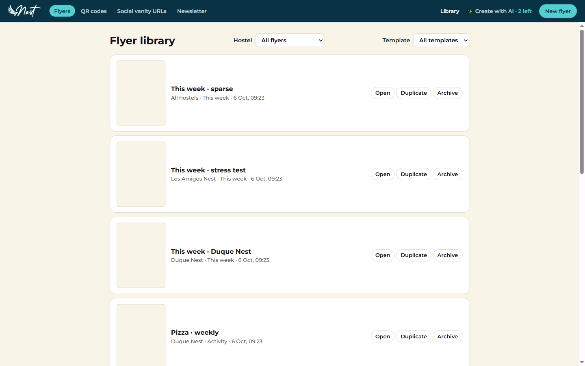
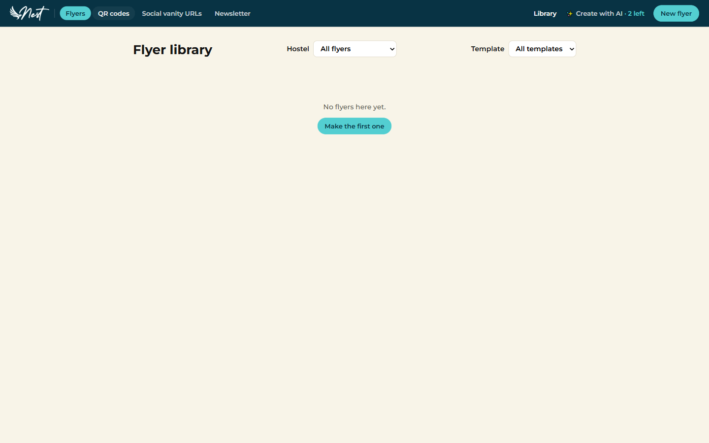
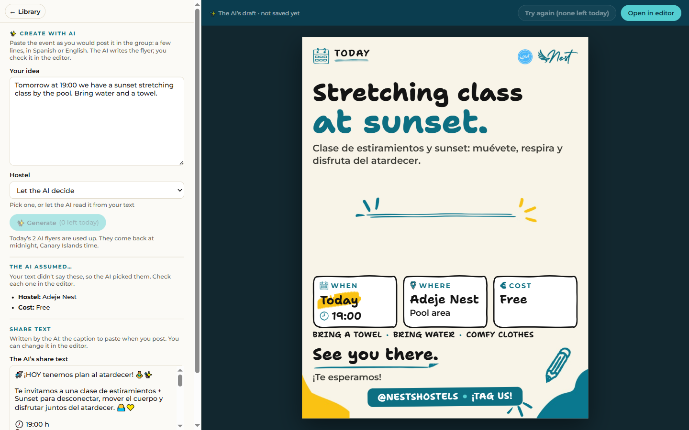
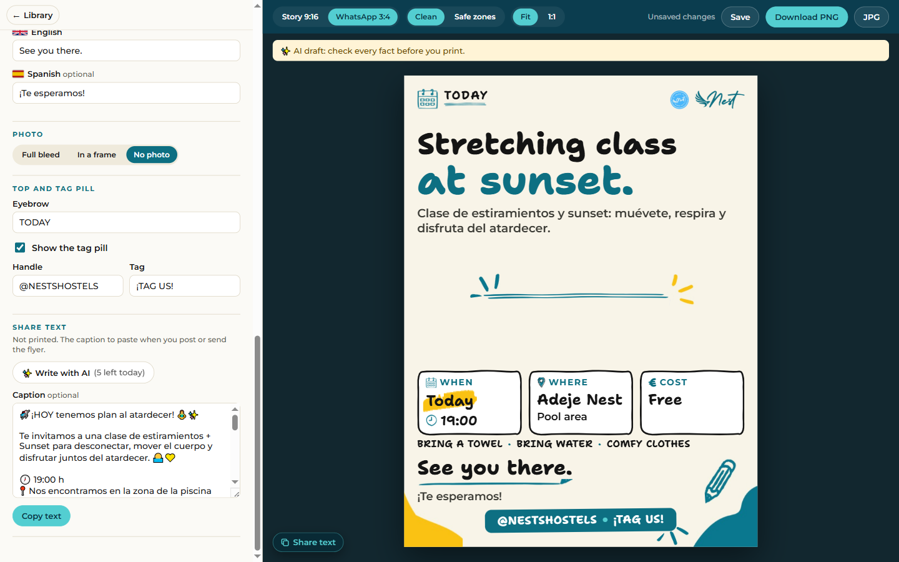
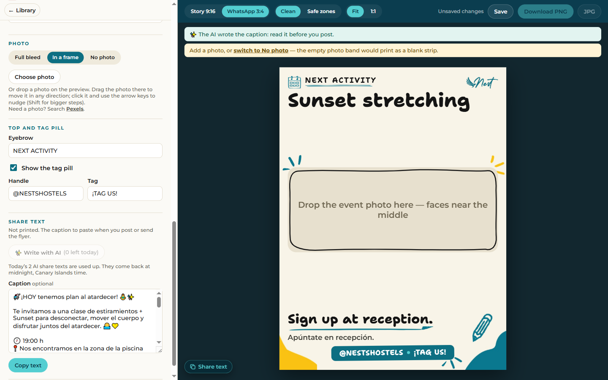
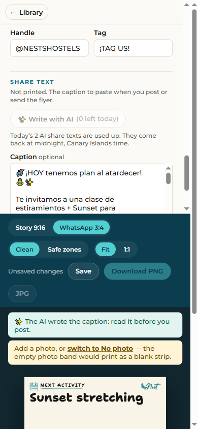
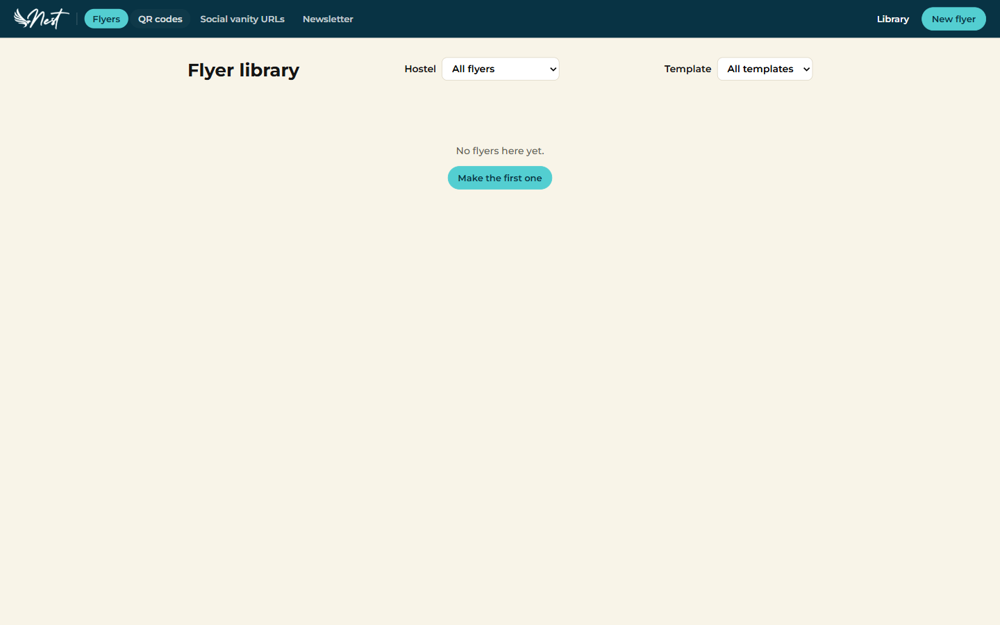
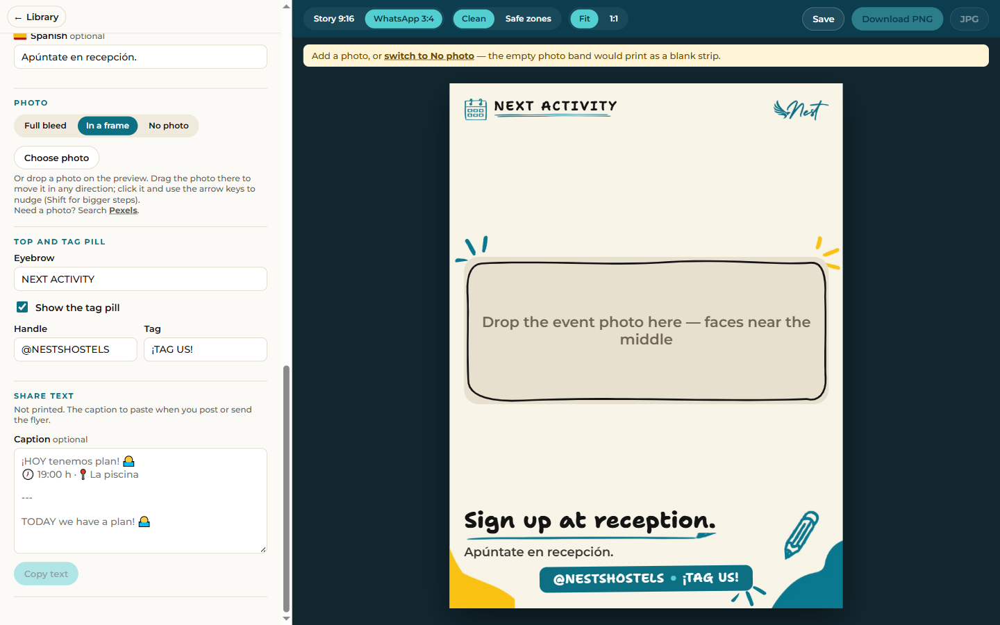

# A flyer from a photo

The brief is `docs/prompts/ai-flyer-from-photo.md`: four stages, one session each. This report has one section per
stage that is built. **A stage with no section here is not built.**

| Stage | State |
|---|---|
| 1. A limit per feature | Built, 2026-10-06 (below) |
| 2. The read, on both backends | Built, 2026-10-06 (below, after stage 1). Its checkpoint, the real reads, is open |
| 3. The page | Not started |
| 4. The picture as the flyer's photo | Not started |

# Stage 1: a limit per feature

Branch `feat/ai-feature-switches`, on top of `684189e`, on 2026-10-06, in the session that planned the feature
(Artur: "Stay on feat/ai-feature-switches"). One commit per piece, each test first. Nothing is pushed, and `main`
stays at `684189e`.

## What it is

One cap covered every AI feature: three flyers used up the day's share texts too. Now each feature has its own
daily limit, set per site. A flyer never uses up a share text, and a feature that ran out says so while the other
still works. It comes before the photo feature because a picture read needs a count of its own.

## Artur's answers (2026-10-06)

| Question | Answer |
|---|---|
| Which features get their own limit? | Every one: `flyer`, `share`, and the one to come |
| What becomes of the single cap? | **"Each feature's default."** `AI_DAILY_LIMIT` and `'dailyLimit'` stay, and mean each feature's number unless it has its own |
| How is a feature's own number written? | **"One setting, pairs":** `AI_DAILY_LIMITS` in `.env`, `'dailyLimits'` in `config.php` |
| When is it built? | **"Own stage, own release,"** before anything of the photo feature exists |
| Where? | In this session, on `feat/ai-feature-switches`. Stages 2 to 4 go to a new session |

**What changes for a site that already set a number:** `'dailyLimit' => 5` was 5 generations a day in all. From this
release on it is 5 flyers and 5 share texts. `docs/deploy.md` says so where the setting is described.

## What was built

| | Node (`.env`) | PHP (`config.php`, the `ai` block) |
|---|---|---|
| Each feature, unless named below | `AI_DAILY_LIMIT=3` | `'dailyLimit' => 3` |
| A feature's own number | `AI_DAILY_LIMITS=share:10` | `'dailyLimits' => ['share' => 10]` |

- **The settings.** Every number is a whole number from 1 to 20, and the default is still 3. Both loaders resolve
  a number for every feature the app has. Refused by the setting's name, never its value: a name no feature has, a
  feature named twice, a number out of range, a pair not written `name:number`, a list where pairs belong. The new
  setting reads digits alone on both backends, so Node accepts no spelling PHP refuses (`1e1`, `2.0`, `+5`). A
  number for a feature the site does not run is accepted and does nothing. One table holds both loaders to this:
  `tests/fixtures/ai-settings.json`.
- **The policy answers `dailyLimit(actor, feature)`:** the feature's own number, else the site's, else 3.
- **The ledger answers a day's count feature by feature, from one read.** `countOk(actorId, day)` returns a count
  under each feature's name, so `api/config` still reads a month's file once however many features run. SQLite
  groups the day's rows by feature; the existing index serves it, so there is no migration.
- **`api/config` lists each feature that runs with its own count:**
  `ai: { enabled: true, features: [{ name, limit, remaining }, …] }`. The single `limit` and `remaining` are gone.
  Each route's `remaining` is its own feature's. The schema is strict and shared, so both backends, the client,
  the contract suite and `docs/api-contract.md` changed in one commit.
- **The used-up sentence names what ran out:** "Today’s 3 AI flyers are used up. They come back at midnight, Canary
  Islands time." and "Today’s 10 AI share texts are used up. …". The nouns are written once, in `src/shared/ai.ts`
  (`AI_FEATURE_NOUNS`), and generated for PHP.
- **The client keeps a count per feature.** The bar and Generate show the flyer's, "Write with AI" the share
  text's. A limit reached empties that feature's count alone. Two functions in `src/shared/ai.ts` are the only
  readers of the answer: `aiFor()` shows a feature, `aiWithRemaining()` moves its count.
- **`npm run ai:smoke`** reads the count of the feature it would call, says what a run spends in that feature's
  own words ("one of this site's 10 AI share texts for today (4 left)"), and names a site that answers the older
  shape as a release from before each feature had its own limit. Nothing is sent to such a site.
- **The Node start-up line** names each feature with its number: `features: flyer (2 a day), share (5 a day)`.
- **The docs:** `docs/deploy.md` (the settings, *Rolling back*, the troubleshooting rows), `README.md`,
  `docs/json-storage.md`, `.env.example`, `config.sample.php`, `CLAUDE.md`.

Not in this stage: a model per feature. It changes the provider seam, so it is stage 2's.

## How each piece was proved

Every piece was red first, for its stated reason.

| Piece | Commit | Seen red | Then green |
|---|---|---|---|
| The brief | `4b2f165` | (a document) | |
| `AI_DAILY_LIMITS` on Node's loader | `0010c90` | 30 tests: the setting was not read | `ai-config` 59 of 59 |
| `'dailyLimits'` on PHP's loader | `96b3b50` | 10 errors and 17 failures: an unknown key | `ConfigTest`, 119 |
| The ledger's count per feature, Node | `17602c3` | 5 tests on both drivers: one number where a count per feature was expected | the storage contract, both drivers |
| The same on PHP | `ed2edd0` | a fatal error: the interface still answered one number | PHPUnit, 805 |
| Each feature its own limit: both backends, the client, the contract | `e182665` | Node: 29 tests in 7 files. PHP: a fatal error with `php/src` put back as it was (the policy took no feature). Browser: with the client broken on purpose to share one count, "a limit reached…" failed | every suite |
| The smoke script | `db2d091` | 2 tests, then 1 more for the hint with its words taken out | `ai-smoke`, 32 |
| The docs | `3ec6898` | (documents) | |

Two of those reds were made on purpose, because the first run had not shown them: PHP's in piece 5 (the code was
put back to the commit before, seen to fail, and restored byte for byte), and the browser's (the client was made to
empty every count, rebuilt, seen to fail, and restored).

## A client and a backend from different releases

While a release is being uploaded, its new files answer beside the old ones. Both directions show no AI, and the
page still loads.

- **This client against an older backend:** three browser tests, one per older answer (one limit with the features
  by name; one limit and no list; no `ai` block at all). Each shows no AI and a working editor.
- **An older client against this backend cannot be run here.** It is read off the released code: `aiFor()` at
  `2c9e5f8`, the source of release `2ad58f28364e`, asks `features.includes(feature)`. The new list holds objects,
  so it finds no name and shows no AI.
- **A client from the releases of 2026-10-03 to 2026-10-05** reads the old `limit` directly and would show a broken
  count. No deployment runs one: the Laragon copy's `release.json` says `2ad58f28364e`, and the live site was on
  `d1f7ddb40170`, from before the AI, when last reported.

## Findings along the way

- **"Try again (uses one of 0 left)."** After the day's last flyer, the greyed button in the result's bar said
  that. Seen in the look on both backends. It is older than this stage: any day's last generation showed it. It now
  reads **"Try again (none left today)"**. The words are mine: change them if they are not yours.
- **The browser suite let `.env` change what it ran against.** `playwright.config.ts` pins every AI setting its
  server counts on, because that server also reads `.env`. It did not pin the new one, so a line such as
  `AI_DAILY_LIMITS=flyer:1` in `.env` failed two tests. Seen red by setting that pair in the surrounding
  environment, which reaches the server the same way (2 failed, 15 passed); with each feature's limit pinned,
  17 passed. The contract suite and PHP's stages never read `.env`.
- **Stopping a `php -S` look stage on Windows leaves its `php` running.** Five such processes outlived their
  shells during the look. Each was confirmed by its command line, stopped by its port, and its temporary folder
  removed. `scripts/php/serve.ts` was not changed: the test suites stop their stages themselves.

## The review

One fresh-context review of the stage's seven commits after the brief (`0010c90` to `3ec6898`), by another agent
that was given the code and not my conclusions. It read the diffs and the changed files whole, and probed the real
PHP classes and the built Node code in memory. It ran no suite and wrote nothing.

**It found no defect in the counting, the settings or the wording, on either backend.** Among what it checked and
found sound: nine scenarios through the real services of both backends gave identical JSON; a switched-off feature
answers `ai_off` before any count and its earlier records move nothing; about 45 strings through Node's loader and
25 values through PHP's turned up nothing but the notes below; fourteen answers `aiFor()` should not read came back
as "no AI".

What it found, and what was done. The brief says to fix what the review finds, each test first:

| What it found | What was done | Commit |
|---|---|---|
| A `null` entry beside a readable one in `ai.features`: the button showed, and its first answer took the whole page down. No backend answers such a list | `aiWithRemaining()` now moves a count, beside `aiFor()` and reading as loosely: an entry it cannot read stays as it came. Red: six unit tests, and a browser test where the caption's field was gone with the page | `90173b8` |
| `aiFor()` showed a count the contract refuses: "-1 left" beside a live Generate | A count is a whole number from zero up. In the same six | `90173b8` |
| The share text's limit reached in the editor had no browser test (the flyer's page had) | Added. It passed as written, so it was seen red with the editor's line for a 429 taken out, and the line put back | `90173b8` |
| The browser suite did not pin `AI_DAILY_LIMITS` | Already found and fixed (above) | `6b25f5c` |
| What a driver does with a later release's record was said in a commit and held by no test | Pinned on each driver and at both services (below) | `c9d619b` |
| Four tests named "a count leaves the others alone" and run one feature | Renamed to what they hold, with where the rest is held. The app has two features, and those tests leave one out | `c9d619b` |
| `docs/deploy.md` showed the old `api/config` answer in one row, and named a release by its date alone | Corrected | `e0d8294` |
| Comments on both backends still spoke of one cap; a docblock lacked `featureNouns` | Corrected | `e0d8294` |
| This report and `CLAUDE.md`'s status were missing | Written | |

**A later release's ledger record, met after going back.** Stage 2 will write `photo` records, and this release may
meet them after a rollback. While one cap covered everything, every record of the day counted against it. Now:

| Driver | What it does with a record of a feature it does not know |
|---|---|
| PHP, JSON | counts it under its own name, so it moves no count of a feature the release runs. A record that names no feature counts for none |
| Node, SQLite | the same |
| Node, JSON | refuses the month: the AI is hidden until the newer release is back |

Each is a test now, and both services have one: such a record counts against no feature the release runs. Seen
red with the counts added up, on both backends, and with PHP's check for a name removed. `docs/json-storage.md`
describes the difference.

**Left as it is, for Artur:**

- **A limit of 1 reads "Today’s 1 AI share texts are used up. They come back…".** The sentence is the one you
  approved, and "1 AI generations" had the same shape before. A site that sets 1 will read it. Mending it needs a
  second noun per feature and a second sentence, on both backends: your words.
- **A feature with nothing for its number is refused:** `AI_DAILY_LIMITS=share:` stops a Node server, and
  `'dailyLimits' => ['share' => null]` answers 503. `null` means "unset" for the block's other keys, so you may
  want it to mean "no own number". It is a row of the settings table now, so changing it is that row and two
  lines.
- **`'share' => 010` in `config.php` is 8,** PHP's octal, before the app sees it. `.env`'s `share:010` is 10.
  Nothing the loader can do: do not write a leading zero.
- **Older, unchanged:** with several settings wrong, Node names `AI_FEATURES` first and PHP `ai.dailyLimit`;
  `AI_DAILY_LIMIT` itself still reads `1e1` and `2.0` on Node; the Node start-up line prints `AI_MODEL` as typed.

**Small things noted and not changed:** the test helper `on()` takes its arguments in two orders across four test
files; `countOk` keeps its name though it answers a count per feature.

## Rulings

Each was mine, with its cost if wrong.

- **`countOk(actorId, day)` answers every feature's count from one read,** not one feature's per call. `api/config`
  asks on every page load and would otherwise read the month's file once per feature. If wrong: one signature, on
  one interface, three drivers and their test doubles.
- **The single number leaves the settings' answer on both backends.** A limit is asked per feature and there is no
  other. If wrong: one field back on two classes.
- **The settings table's accepted rows say which features differ and what the rest get,** so adding `photo` edits
  no row. If wrong: a fixture's shape.
- **`aiFor()` still shows a feature listed beside an entry it cannot read.** The other choice was "any odd entry
  hides the AI". A later backend will list a feature this client has no name for, and that must not cost the
  features it does know. If wrong: one line.
- **A route that answers with no count to show leaves the count as it was.** The flyer just made stays on screen,
  and the server still refuses at the limit. If wrong: the number on a button is stale until the page is loaded
  again.
- **The browser suite pins each feature's limit in the setting's own words** (`flyer:3,share:3`), not as an empty
  value: an empty variable is not reliably set on Windows. If wrong: one line of configuration.
- **"Try again (none left today)"** is my wording.
- **One picture of the old button is kept** beside the report (`before-the-fix-…png`): it is the finding.

## The look in a real browser

**Not in Artur's own Chrome.** The Claude extension was not connected, so the look ran in Playwright's Chrome 143,
with its own profile. A script walked the same path on both backends at 1440 × 900 and 390 × 844, and every
screen was read in a screenshot.

- **Node** was the built app on a throwaway data folder. **PHP** was a `php -S` stage with the built client
  (`scripts/php/serve.ts`). Both ran the fake provider: nothing was spent.
- The limits were different per feature on purpose: 2 a day and 5 for the share text; then 3 a day and 2 for the
  share text, to use that one up.
- The Laragon copy was not used and not changed.

| What was looked for | Node | PHP |
|---|---|---|
| Each button shows its own count | the bar "Create with AI, 2 left today", "Generate (2 left today)", "Write with AI (5 left today)" | the same |
| A flyer leaves the share text's count alone | two flyers: 2 → 1 → 0, and "Write with AI" still says 5 | the same |
| A share text leaves the flyer's alone | two share texts: 2 → 1 → 0, and the bar still says 3, with Generate live | the same |
| The flyer's used-up sentence | "Today’s 2 AI flyers are used up. They come back at midnight, Canary Islands time." under a greyed Generate | the same |
| The share text's | "Today’s 2 AI share texts are used up. …" under a greyed "Write with AI" | the same |
| The question before a caption is replaced | "It uses one of the 5 generations left today.", and with one left "It uses the last generation left today." | "the last generation" seen; the first caption went into an empty box, which asks nothing |
| `api/config` afterwards | flyer 0 of 2, share 4 of 5 | the same |
| A site with the share text alone | no "Create with AI" on the bar, `#/ai` typed by hand opens the library, "Write with AI (5 left today)" | the same |
| A site with the flyer alone | "Create with AI, 2 left today", "Generate (2 left today)", no "Write with AI" in the editor | the same |
| A number for a feature the site does not run | the flyer-alone site started with `share:5` set, and ran | the same |
| On the phone | the bar's entry is "✨ AI", every count and sentence as on the desktop, no sideways scroll | the same |
| After the day's last flyer | "Try again (none left today)", greyed, and "Open in editor" live | the same |

| | Node | PHP |
|---|---|---|
| The library: the bar's count is the flyer's |  |  |
| The flyers used up, and the corrected button |  |  |
| Meanwhile "Write with AI" still has its five |  |  |
| The share texts used up |  |  |
| The same on a phone |  |  |
| A site with the share text alone |  |  |
| A site with the flyer alone: no "Write with AI" |  |  |

Also in `ai-flyer-from-photo/`, for each backend: the AI page after one flyer (`…-desktop-ai-flyer.png`), the phone's
library, used-up page and editor (`…-phone-library.png`, `…-phone-ai-used-up.png`, `…-phone-editor-share.png`,
`…-phone-ai-try-again-none-left.png`), and the rest of the one-feature sites at both sizes
(`…-share-alone-…`, `…-flyer-alone-…`). `before-the-fix-try-again-one-of-0-left.png` is the button as it was.

## The release

**None was built, and nothing outside this folder was touched.** The Laragon copy still runs `2ad58f28364e` with
the share text alone. `.env` was not changed. The live site was not called.

A release of this stage needs this order on a host: the release first, `'dailyLimits'` second, and `'dailyLimits'`
out again before going back. Release `2ad58f28364e` and older refuse that setting (503). `docs/deploy.md`,
*Rolling back*, has the row.

## The gates

One sequence on 2026-10-06, on the tree of `e0d8294`: the stage's last code commit.

| Gate | Result | On `2c9e5f8` (the last report) |
|---|---|---|
| `npm run gen` | every generated file up to date | the same |
| `npm run typecheck` | 0 errors | 0 |
| `npm test` | 28 files, 492 tests passed | 28 files, 448 tests |
| `npm run test:contract` | 38 files, 359 tests passed (7 files and 215 tests skipped by project) | the same |
| `npm run test:php` | 810 tests, 9,858 assertions, 37 skipped (PHP 8.3.4) | 781 tests, 9,779 assertions |
| `npm run test:render` | 135 passed, 1 skipped (the opt-in baseline) | 130 passed |
| `npm run test:php-smoke` | 2 passed | 2 passed |
| `baseline.spec.ts` | 32 cases byte-identical against a capture of `4b2f165`, taken before any code changed | 32 |

- **No test touches a provider, and no provider was called in this stage,** by a test, a script or the look.
- The same gates were green on `3ec6898`, before the look and the review: 482 unit tests, 806 PHP tests, 132 in
  the browser. The difference is the tests the look and the review added.
- **Tests added as pins,** green from the start because the code was already right: the share text's limit in the
  editor, a later release's record on each driver and at both services, and the settings row for a number left
  empty. Seen to fail with the code broken on purpose: the editor's test, both services' tests, and PHP's "names
  no feature". Not seen to fail: the three driver tests whose assertion is the exact answer (PHP's and SQLite's
  "counted under its own name", Node's JSON "refuses the month") and the settings row, which runs on both loaders.
- The 37 skipped PHP tests are the same 37 as before.

## What is left

- **Nothing is pushed.** `main` is at `684189e`. This branch is ahead of it by the stage's commits: the brief, seven
  pieces, five fixes, and this report.
- **Artur's:** whether `main` moves to this branch; and the release, when you want it. It can go up before stage 2,
  as you chose ("own stage, own release"). On a host: `npm run build:php` and upload, `npm run deploy:tag -- <the
  site>`, and only then any `'dailyLimits'`.
- **For Artur to decide** (each is above, under *The review*): the sentence at a limit of 1; a feature with nothing
  for its number; the words "Try again (none left today)".
- **Stages 2 to 4** are for a new session, on `feat/ai-flyer-from-photo`, cut from this stage's last commit.

**For the session that builds stage 2,** what this stage leaves ready:

- Adding `photo` to `AI_FEATURES` does not compile until `AI_FEATURE_NOUNS` has its noun ("picture reads").
- The settings table needs no row edited for it, and `playwright.config.ts` pins its limit by itself.
- The four tests that leave one feature out will then run two. Their `call` and `BODY` maps need a `photo` entry,
  and their names can say "a count leaves the others alone" again.
- `aiFor()` and `aiWithRemaining()` are the only readers of `api/config`'s `ai` block in the client.
- This release already does what the brief's stage 2 says of an older build that meets a `photo` record, and tests
  hold it there.
- After a look, check for `php -S` processes left on the look's ports.

# Stage 2: the read, on both backends

Branch `feat/ai-feature-switches`, on top of `650d3a9`, on 2026-10-06. Asked which branch, Artur chose "Stay on
feat/ai-feature-switches" again. One commit per piece, each committed as it went green on his go-ahead for the
stage ("Commit each as it goes green"). Nothing is pushed, and `main` stays at `684189e`.

**The checkpoint is open.** Everything below is built and green. The real reads have not been run: they wait for
Artur's go and his pictures. No provider was called in this stage, by a test, a script or by hand.

## What it is

The server can read a picture into the words it shows. `POST api/ai/photo` takes a picture and answers those words;
a staff member will check them in "Your idea" and then ask for the flyer, as with any text. It is a third AI
feature, `photo`, with its own switch, daily limit and model. There is no page yet: that is stage 3. With `photo`
not named in a site's settings, the app looks and behaves exactly as before.

## What was built

| | Node (`.env`) | PHP (`config.php`, the `ai` block) |
|---|---|---|
| The read runs | `photo` in `AI_FEATURES` | `'photo'` in `'features'` |
| Its daily limit | `AI_DAILY_LIMITS=photo:5`, else `AI_DAILY_LIMIT` | `'dailyLimits' => ['photo' => 5]`, else `'dailyLimit'` |
| Its model | `AI_MODELS=photo:<model>`, else `AI_MODEL` | `'models' => ['photo' => '<model>']`, else `'model'` |

- **The route.** `POST api/ai/photo`, the picture as a file in the field `photo`, answers `{ text, remaining }`.
  Checks in the contract's order: the write guard, `ai_off`, `ai_forbidden`, the photo route's own checks with its
  messages, the reads' limit, the provider. Nothing is written to `uploads/`.
- **The words.** 0 to 4000 characters, so they always fit the idea box. `[?]` stands where the model could not
  read a word. An empty text means the picture has no words, and that read counts.
- **The used-up sentence:** "Today’s 3 picture reads are used up. They come back at midnight, Canary Islands time."
- **What the model gets:** the picture upright, without its metadata, at most 2048 px on its long edge, a PNG when
  it has transparency and a JPEG otherwise; the reader's rules (`ai/prompts/photo.md`); and one fixed line. No
  hostels, no date, no examples.
- **The provider seam carries a picture** on both backends. Anthropic gets an image block and then the text;
  OpenAI an `input_image` at high detail and an `input_text`. A text turn goes out exactly as before: the existing
  vectors' bodies were not edited.
- **A model per feature.** One provider and one key serve every model. The call names its model.
- **One photo intake per backend,** used by both routes that take a picture. `POST api/photos` behaves as before.
- **What a site keeps.** The picture as it was sent, in `ai-pictures/<Canary day>/` of the data folder, never
  served, for 30 days. It is written before the provider is asked. The ledger's record names it in one line and
  never holds it. `GET api/config` deletes what is past its days, at most once a day, AI on or off.
  `deploy:backup` and `npm run copy` leave the folder out.
- **The fake provider reads pictures:** it answers its first example's text, and a picture's width steers it
  (11 px a bad answer, 12 a timeout, 13 a refusal, 14 no words).
- **`npm run ai:smoke -- --photo <picture | case .json> [--save <file>] [--to <site>]`:** one real read by hand.
- **The eval set,** `docs/ai-flyers/image-examples/`, held to its shape by a test. Its first case is not committed
  yet (below).
- **The docs:** `docs/api-contract.md` (written first), `docs/deploy.md`, `docs/json-storage.md`, `README.md`,
  `.env.example`, `config.sample.php`, `docs/ai-flyers/README.md`, `CLAUDE.md`.

## How each piece was proved

| Piece | Commit | Seen red | Then green |
|---|---|---|---|
| The seam carries a picture | `9b6271d` | the picture's request entry alone, twice on each backend | 415 unit, 812 PHP |
| A model per feature | `15c926c` | Node: 22 tests (the setting was not read), then the service's test with the model taken out of the call. PHP: 10 errors and 14 failures, then a fatal error (the interface still asked a provider for its model) | 516 unit, 837 PHP, the contract suite |
| One photo intake, Node | `37ce322` | 7 tests: neither function existed | the photo contract tests, untouched |
| One photo intake, PHP | `a61c15a` | 5 errors: no class | 842 PHP; the photo contract tests, untouched |
| The reader's prompt, the schema, the bundle | `6743310` | Node: 9 tests. PHP: 2 errors, 2 failures | 528 unit, 844 PHP |
| The fake reads pictures | `7996a38` | Node: 4 tests. PHP: 1 error, 1 failure | 451 unit, 846 PHP |
| The kept pictures and their deleting, Node | `6c372b5` | the test file could not load: no module | 539 unit |
| The same on PHP; backup and copy | `c7fc00a` | PHP: 5 errors, 3 failures. The restore drill: a backup carried the folder | 855 PHP, the cross tests |
| `photo` joins the features: service and route, both backends | `65395c6` | Node: 49 tests. PHP: 39 errors, 8 failures | 558 unit, 872 PHP, 374 contract |
| The smoke's `--photo` | `98d7967` | 12 tests | 568 unit |
| The eval set's test | `d5cd8a3` | not seen red: a pin | |
| The docs | `6ca9b83` | (documents) | |
| What the review found | `5ed6af0` | Node: 4 tests. PHP: 1 error, 5 failures | 577 unit, 878 PHP, 378 contract |

**Not seen red, said plainly:**
- The contract suite's cases for the read were written before either route existed but first run after Node's.
- `npm run copy` leaving the kept pictures behind: it never carried them. A pin.
- The eval set's test: it passed against the case on this machine.
- PHP's guard for a folder it cannot list: no test can make `scandir` fail here.
- PHP's link test is skipped on this Windows account, which cannot make a link. Node's runs.

**One piece is one commit where the brief has two.** `photo` joined the features on both backends together: the
list is generated for PHP and both backends' tests run over it, so the name on Node alone would leave PHP red.
Stage 1's fifth piece was one commit for the same reason.

## What the providers' docs said (read 2026-10-06)

- **Anthropic:** an `image` block with a `base64` source, before the text. At most 10 MB a picture in base64.
  `claude-haiku-4-5` reads at up to 1568 px on the long edge; Claude 4.7 and later at 2576. Structured outputs list
  Haiku 4.5 and name no conflict with pictures. Haiku 4.5 still says "not sooner than 15 October 2026".
- **OpenAI:** `input_image` with a data URL and `detail`, and `input_text`. At `high` the current models read at
  most 2048 × 2048 and 2,500 patches of 32 px, about 1,600 px square. The page names `gpt-6-astra` and the `gpt-5.6`
  family, not `gpt-6-luna`.
- **What follows:** both default models shrink a 2048 px picture themselves, and only a stronger Claude uses all
  of it. That is a number for the checkpoint's table, not a change: 2048 and `high` are built as the brief says.

## The review

One fresh-context review of the twelve commits `9b6271d` to `6ca9b83`, by another agent that was given the code and
the brief and not my conclusions. It read the diff and the changed files, and ran five small probes in memory. It
ran no suite and wrote nothing.

**It found no way for a switched-off read, the AI off, or a request without the write header to read a file,
prepare a picture, keep one, ask a provider, count or record.** It also found sound: the order of checks on both
backends, the ledger's line byte for byte, the 30-day boundary, the adapters' picture parts against the vectors,
`POST api/photos` unchanged by the intake's split, and that neither the key nor a picture reaches `api/config`, the
ledger or an error message.

What it found, and what was done (`5ed6af0`), each test first:

| What it found | What was done |
|---|---|
| A file under another field's name was a 500 on Node, where PHP answers `no_photo_field`. Older than this stage on `api/photos`; the shared intake gave it to the read | `no_photo_field` on both routes and both backends, in the contract and its suite |
| One day's folder that could not be deleted ended the whole clean-up for good: always first in the listing, and the day never marked. On PHP, a walk of the folder and a log line on every page load | Each folder is tried, the day is marked, one line names what is stuck |
| PHP's clean-up followed a link where a day's folder belongs, and would delete what it points at | A link is never followed. A test holds Node, which never did |
| PHP read a folder it could not list as one entry with no name, itself, and recursed about 4,000 deep, logging each step | It is an error now |
| PHP's day pattern took a name ending in a line break | `\z` |
| `'models'` and `'apiKey'` on PHP took a no-break space; Node refuses it | Both read spaces as JavaScript's `\s` does. Two rows in the settings table |
| When a picture could not be kept, PHP's trace printed its first 15 bytes into the log | The argument is marked sensitive |
| `--save` wrote a JPEG under any name | It refuses a name that does not say what the file holds |
| `.swept` was written once in each backend | A shared fact now (`STORAGE_FILES`) |
| A test named an order and tested none; a check that could not fail | Cases with two faults at once; the check is gone |

**Left as it is, with the reason:**
- **The eval set's test does not yet hold a case to the format a read sends.** The case on this machine is a PNG
  without transparency, which a read sends as a JPEG. The check goes in with the case, once Artur has looked at it
  (below): adding it now would fail on a file that is his to replace.
- **A partial upload** (new `php/src`, old `schema/ai.json`) answers 500 on `api/config` for a site with the AI on,
  even one that never names `photo`. It is the known rule, "upload a release whole", and `docs/deploy.md` says so.
- **A request the host kills mid-call** leaves a kept picture with no ledger record.
- **Noted, not changed:** the kept picture's path pattern is used by the Node tests alone, and PHP's tests spell
  their own; the picture extensions are listed in three places.

## For Artur to decide

1. **A read that fails is free, and keeps its picture.** Both are your decisions: a failed call never counts, and a
   failed read's picture is the one worth having. Together, on a site with no lock, they have no bound: a stranger
   with a script can send pictures that fail (a page of dense text makes an answer over 4000 characters, which
   also pays the provider each time) and fill the disk, about 0.3 MB a picture. The live site has hit its disk
   quota once. The smallest change that reopens neither decision is a second, higher daily number for *attempts*.
   I did not build it: it is a new rule.
2. **The reader's prompt's words** (`ai/prompts/photo.md`). They are mine, from the brief's seven rules, plus one
   line the first case asked for: a brand badge or a slogan that names no hostel is left out ("ONE PASS · MORE
   HOSTELS" on the Canva page). The plan said you would read them before their commit; your later go-ahead to
   commit each piece as it went green overtook that, so they are committed and waiting for your eye. Changing them
   is that file and `npm run gen`.
3. **The first case's picture.** It shows, besides the flyer: browser tabs ("…est Hostel", "La Isleta Nest Hostel",
   "KPIs HOSTALES NEST", "Pinterest"), a piece of the Canva address ("…QxFI819skn5Q/edit"), three bookmarks
   ("La Isleta Nest Gran…", "CHECK OUT LA ISLE…", "Worldpackers") and the Windows taskbar. As a read would send it,
   it is a JPEG of 154 KB, not the PNG of 1.4 MB. Cropping the tabs away would weaken the case: leaving out what
   surrounds the flyer is one of the rules it tests. Say yes and I commit the case with that JPEG.
4. **A PNG with transparency stays a PNG,** as the brief says. A very large one could pass Anthropic's 10 MB and
   answer `ai_failed`.
5. **Older, unchanged:** the three items stage 1 left (the sentence at a limit of 1, a feature with nothing for its
   number, "Try again (none left today)").

## Rulings

Each was mine, with its cost if wrong.

- **The call names its model,** instead of one provider built per model. If wrong: one field moves back.
- **A read longer than the idea box fails** (`ai_failed`, nothing counted), as any answer over a limit does. The
  other choice was to cut it. If wrong: one line in each service.
- **The words are trimmed,** so a read of spaces alone is "no words". If wrong: one call in each service.
- **Kept for 30 days** means a day's folder goes once that day is more than 30 days before today's Canary day.
- **A disk that cannot keep the picture answers the app's ordinary 500,** logged, with nothing spent or recorded.
- **The route prepares the picture and the service takes it prepared,** on both backends, so the service owns no
  image work. If wrong: one call moves.
- **The kept pictures have a second implementation, in memory,** for the tests and the smoke's direct read.
- **The fake's widths are 11 to 14 px:** small enough that neither backend ever shrinks them.
- **The read's route asks the switch before any of the upload's checks,** so a site that does not run it says
  nothing about the file.
- **`photo` in the docs is "the server's half":** a host is told to leave it out of `'features'` until the page's
  release, since naming it shows nothing.

## The look in a real browser

**None, and none is owed by this stage:** it has no page. What stands in for it is the baseline, byte-identical
over 32 cases against a capture of `650d3a9` taken before any code changed, and the whole render suite, whose AI
server now names `photo` among its features and shows nothing new.

## The release

**None was built, and nothing outside this folder was touched.** The Laragon copy still runs `2ad58f28364e` with
the share text alone. `.env` was not changed. The live site was not called.

A release of this stage needs this order on a host: the release first, then `'models'` and `'photo'`; both out
again before going back. Every release up to `2ad58f28364e` refuses them (503). `docs/deploy.md`, *Rolling back*,
has the row, and says that such a release never cleans `data/ai-pictures/`.

## The gates

One sequence on 2026-10-06, on the tree of `5ed6af0`: the stage's last code commit.

| Gate | Result | On `e0d8294` (stage 1) |
|---|---|---|
| `npm run gen` | every generated file up to date | the same |
| `npm run typecheck` | 0 errors | 0 |
| `npm test` | 31 files, 577 tests passed | 28 files, 492 tests |
| `npm run test:contract` | 38 files, 378 tests passed (7 files and 235 tests skipped by project) | 359 tests |
| `npm run test:php` | 878 tests, 10,161 assertions, 38 skipped (PHP 8.3.4) | 810 tests, 9,858 assertions, 37 skipped |
| `npm run test:render` | 135 passed, 1 skipped (the opt-in baseline) | 135 passed |
| `npm run test:php-smoke` | 2 passed | 2 passed |
| `baseline.spec.ts` | 32 cases byte-identical against a capture of `650d3a9`, taken before any code changed | 32 |

The same sequence was green on `6ca9b83`, before the review: 572 unit tests, 374 contract tests, 135 in the
browser, the baseline identical. The difference is the tests the review added.

- **No test touches a provider, and no provider was called in this stage.**
- The 38 skipped PHP tests are the 37 as before and the link test.

## What is left

- **The checkpoint: the real reads,** on your go. Your pictures: the Canva page, a handwritten board, a poster, a
  chat screenshot, a photo with no words. Each on both providers, on the default model and on a stronger one named
  through `AI_MODELS`, and one through the Laragon copy for PHP's side. You get the table: the picture, the model,
  the seconds, the tokens, what was misread. Then you choose the photo's model and whether 2048 px stays.
  - This machine's `.env` names `flyer,share`. The reads would run with `AI_FEATURES` and `AI_MODELS` set in the
    command's own environment, which wins over `.env`: `.env` is not changed, and no key is printed.
  - The Laragon copy needs the new release (`npm run deploy:update`) and `'photo'` named for that one read, by a
    script that prints nothing of its `config.php`. Say how it should be left.
- **The first case** of `docs/ai-flyers/image-examples/`, after your look (above).
- **Nothing is pushed.** `main` is at `684189e`.
- **Stages 3 and 4** are not started.

**For the session that builds stage 3,** what this stage leaves ready:

- `aiFor(ai, 'photo')` already answers the reads' own `{ limit, remaining }`; nothing in the client asks it yet.
- The browser's `preparePhoto()` takes its limits as an argument: `AI_PICTURE_MAX_EDGE` is in `src/shared/ai.ts`.
- The client's API helper sends a form as it is (`uploadPhoto` is the model for the read's call).
- The fake answers a read with its first example's text, so a read and then Generate give that example's flyer.
  A picture 14 px wide is "no words"; 11, 12 and 13 are the failures.
- `playwright.config.ts` names `photo` and pins its limit by itself; the suite's pictures must not be 11 to 14 px
  wide by accident.
- A read's failure early (the switch, the write guard) may answer before a large upload is taken: a browser can
  see a dropped connection there instead of the refusal. No page shows the read where it is off, so it has not
  mattered yet.
